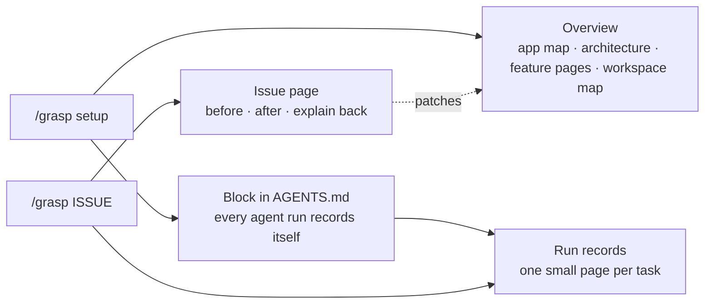
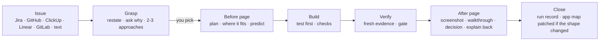
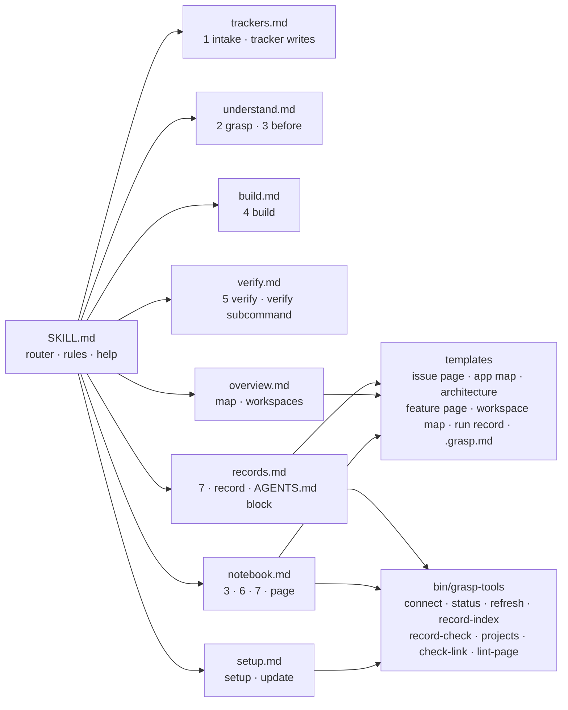

<p align="center">
  
</p>

<h1 align="center">grasp</h1>

<p align="center"><b>Build it, and grasp it.</b></p>

<p align="center">
  A skill for coding agents that works one issue from any tracker so the people who own the code
  understand it <b>before</b> it is built and <b>after</b>, not just that the tests pass. It also
  explains the app it is installed in and keeps a record of every agent run, so nobody has to ask
  "what did the AI actually do?".
</p>

<p align="center">
  <a href="#quick-start">Quick start</a> ·
  <a href="#what-you-can-open">What you can open</a> ·
  <a href="#what-a-run-looks-like">What a run looks like</a> ·
  <a href="#how-it-is-built">How it is built</a> ·
  <a href="docs/research/README.md">Research</a>
</p>

<p align="center">
  <a href=".claude-plugin/plugin.json"></a>
  <a href="LICENSE"></a>
  <a href="#quick-start"></a>
</p>

## What you can open

grasp writes three kinds of page into the repository's `docs/how-it-works/`. They are plain
Markdown with Mermaid diagrams, so the folder opens as an Obsidian vault and renders on GitHub.



| Page | The question it answers | Written |
| --- | --- | --- |
| **App map** and **feature pages** | What is this app, what can it do, how does each feature work, how do they connect? | By `setup`, refreshed by `map`, patched when an issue changes the shape |
| **Architecture page** | What is the design called, why is it built this way, what breaks first, and where do I learn those ideas? | With the app map, once the app is past about 15 source files |
| **Workspace map** | How do these projects (frontend, backend, infra...) fit together? | By `setup` in a top folder that holds several projects, with an app map per sub-project |
| **Issue page** | What did this change do, how, and why that way? | By a `/grasp ISSUE` run: a before half, then an after half |
| **Run record** | What did the agent do in that session, was it checked, what went wrong, what is left? | By every agent run that changed files, grasp or not |

Start at `docs/how-it-works/runs/README.md` for "what has been happening", and at
`docs/how-it-works/app-map.md` for "how does this work".

## What a run looks like



This is the default flow, as printed by `/grasp help`:

```text
BY DEFAULT
  1 Intake    read the issue, comments and attachments (read only)
  2 Grasp     restate it, ask what is unclear one question at a time, show 2-3 approaches
              with a recommendation, and wait for your pick
  3 Before    write the "before" half of the issue's learning page: diagrams first (where
              it fits, expected flow, the decision), detail folded; one prediction question
  4 Build     branch, test first, smallest change, the project's own checks
  5 Verify    fresh evidence only: checks, the test failing without the fix, the behaviour seen
  6 After     write the "after" half: screenshot, how it works with a numbered code
              walkthrough, decision, blockers, up to 3 checked learning links; then one
              explain-back question
  7 Close     write the run record; patch the app map and the feature page if the issue
              changed how the app is put together; report
```

## What it does

| Capability | What happens |
| --- | --- |
| **Understands first** | Restates the ask, asks why when the issue doesn't say, asks one question at a time and lays out two or three approaches. No code until you pick one. |
| **Any tracker** | Jira, GitHub Issues, ClickUp, Linear, GitLab, Azure DevOps, any other tool you can connect, a `.md` file or plain quoted text, all read through one intake contract. `setup` reads one real issue to prove the tracker works in your project. |
| **Builds test-first** | Branch per project convention, failing test first, smallest change, the project's own checks. Asks before any push, pull request or tracker write. |
| **Verifies with evidence** | "Verified" means a check ran green in this run and its result is quoted. `verify` proves an existing fix without touching code. |
| **Leaves a visual learning page** | One page per issue in the repository's root `docs/` (Obsidian-compatible Markdown, listed in the docs router), or in Notion on request. You can scan it in a minute: each section is a caption and a picture (where it fits, a before/after screenshot, how it works, the decision), with the detail folded underneath: a numbered code walkthrough, files touched, how to check it. Blockers are never folded. The plan is a list of 3 to 6 steps, ticked while the agent builds, so the page shows progress live; after the build, "Planned and built" says what was built instead and why. Each page names the concepts it leans on: one line each, with the longer explanation and live-checked lessons (docs, YouTube, LinkedIn Learning) in a toggle. It ends with an explain-back question that waits for your answer or "skip": the page is marked built only then. |
| **Keeps pages short** | `lint-page` fails a page with more visible words than its kind allows (run record 150, issue page 400, feature page 350, architecture page 900, app map 1,100), a diagram with more than 20 boxes, no Concepts section, an architecture page with no lesson, or a built page whose explain-back was never answered. Long text goes in a toggle, never on the page. |
| **Reviews and resolves pull requests** | `review PR` checks a pull request against its issue and the project's written rules and reports verified findings; `resolve PR` works the review threads in one new commit. Both update the issue page so it says what the code does now. |
| **Explains the app** | `setup` reads the code and writes an app map: what the app is for, its core features in the users' words, a picture of how the features connect, the pieces, and one request traced end to end. A feature with a path worth tracing gets its own short page; a small app gets the map alone, so the pages scale with the code. Every row names the file it came from; what couldn't be confirmed is listed as "Not sure yet", not drawn as fact. The app map names up to five concepts a newcomer must know, each with a folded explanation and checked lessons. With `illustrations: yes` (asked once at setup) the app map, the architecture page, the workspace map and each issue page open with one generated illustration. |
| **Teaches the architecture and system design** | The architecture page names the design, draws which part may call which and what happens on a failure, and lists each design choice with what it buys and what it costs. The system design ideas behind it are each explained with an everyday picture, where this code does it and when not to use it, then a table of live-checked YouTube and LinkedIn Learning lessons, easiest first. An app with a UI also gets its design system: tokens, components, rules. |
| **Handles a folder of projects** | Run `setup` in a top folder that holds several repositories or monorepo apps and it maps each one, then writes a workspace map of what passes between them, each connection with the file that shows it. It checks first that git won't silently ignore the pages. |
| **Records every agent run** | `setup` adds an 18-line block to `AGENTS.md` (or `CLAUDE.md`) telling every agent to finish a task by writing a run record: asked, changed, checked, problems, next, and one small diagram when the change has a shape. A record stays under 150 visible words; longer detail is folded. Bug fixes, small changes and failed runs included. A table lists every run, newest first. An optional Stop hook reminds an agent that forgets. |
| **Plugs into your own skills** | `setup` finds this project's skills that work issues, verify, review or resolve, and lets you pick which to connect. Each picked skill keeps its own job and gains a short marked block that calls `/grasp page` for the learning page. `update` pulls the latest grasp and refreshes those blocks. |

## Quick start

**Any agent, one line** (Claude Code, Codex, Cursor, Gemini CLI and the other agents the
[skills CLI](https://github.com/vercel-labs/skills) knows). Needs Node.

```bash
npx skills add junrillg/grasp -g     # every agent it detects; add -a codex to pick one
npx skills update grasp -g           # later, to update
```

Run it as `/grasp ISSUE`. Start with `/grasp setup` in your project.

**Claude Code plugin.**

```
/plugin marketplace add junrillg/grasp
/plugin install grasp@grasp
```

Run it as `/grasp:grasp ISSUE`. Update with `/plugin marketplace update grasp`.

**Any agent, by link.** Needs `git` and `bash`; a `git pull` then updates every agent at once.

```bash
git clone https://github.com/junrillg/grasp.git ~/Projects/grasp
~/Projects/grasp/install.sh                        # links into ~/.claude/skills and ~/.agents/skills
~/Projects/grasp/install.sh --project ~/code/app   # or one project only
```

The installer prints one line per folder it links, for example
`link ~/code/app/.claude/skills/grasp`. Run it as `/grasp ISSUE`; `git pull` updates it.
`--copy` copies instead of linking, and `--uninstall` removes what it installed.

**First useful run.** Set grasp up in your project, then plan an issue without writing any code:

```
/grasp setup
/grasp PROJ-123 --plan
```

More examples:

```
/grasp help
/grasp #42                      full run on a GitHub issue
/grasp "add CSV export to the report page" --notebook off
/grasp verify PROJ-123          prove an existing fix works, fill the after page
/grasp review 42                review a pull request, update its issue page
/grasp resolve 42               work the review threads on your pull request
/grasp page PROJ-123 --step verify   refresh the page after your own verify skill ran
/grasp record                   write down what this session did, in five lines
/grasp map                      refresh the overview of the app and its features
/grasp update                   pull the latest grasp, refresh connected skills
```

**Trackers and notebook.** Connect whatever you use: `gh` for GitHub, the Atlassian MCP server
for Jira, the ClickUp MCP server, the Linear MCP server, `glab` for GitLab, `az` or the Azure
DevOps MCP server, or a project's own wrapper script. `setup` tests it on one real issue and
records the result in `.grasp.md`. Pages go to
`docs/how-it-works/` at the repository root by default, in Markdown that opens as an Obsidian
vault and renders on GitHub; the first run confirms that folder with you, and on a yes writes the
vault settings so links you make in Obsidian stay standard Markdown. Pass
`--notebook notion` (with the Notion MCP server connected) to use Notion instead. The first run in
a repository runs `setup` and saves `.grasp.md`.

**Updating.** `/grasp update` works out how grasp was installed. For a linked install it runs
`git pull --ff-only` in the grasp repository. For the plugin it asks you to run
`/plugin marketplace update grasp`. For a `--copy` install it re-copies from the repository
recorded in the copy's `.source` file. It then refreshes grasp's block in every connected skill
and in `AGENTS.md` or `CLAUDE.md`, after showing you the change. A grasp release that doesn't
change a block leaves your files untouched.

**Run records without grasp.** The block in `AGENTS.md` spells out the five lines and the diagram, so a teammate's
agent with no grasp installed still writes a record the table can read. To check a branch from
the command line or CI: `grasp-tools record-check` exits 1 when files changed and no record was
added.

## How it is built

grasp is plain Markdown in the open Agent Skills format, plus one small bash helper for the
steps that must be exact (editing your skills, checking links, checking pages render). There's
nothing to compile. `SKILL.md` is a short router, and each workflow step loads only its own reference, so
an agent reads the detail a step needs and nothing else.



| Path | What it holds |
| --- | --- |
| [`skills/grasp/SKILL.md`](skills/grasp/SKILL.md) | Arguments, help, the rules for every run and the seven-step workflow |
| [`skills/grasp/references/`](skills/grasp/references/) | One file per step, loaded only when that step runs |
| [`skills/grasp/templates/`](skills/grasp/templates/) | The issue page, the app map, the architecture page, the feature page, the workspace map, the run record and the `.grasp.md` project settings |
| [`skills/grasp/bin/grasp-tools`](skills/grasp/bin/grasp-tools) | The exact, testable steps: connect, disconnect, block, status, refresh, record-index, record-check, projects, check-link, lint-page, version. Needs only bash, sed, awk, curl and git |
| [`tests/`](tests/) | Plain-bash tests for `grasp-tools` and the skill docs, plus the Obsidian render check |
| [`.claude-plugin/`](.claude-plugin/) | Plugin and marketplace manifests for Claude Code |
| [`install.sh`](install.sh) | Links or copies the skill into each agent's skills folder |

## Why it works this way

Every design choice traces to research notes in [docs/research](docs/research/README.md):
delegating the thinking is what loses understanding, a short spec before the build beats a long
one nobody reads, and one prediction question plus one explain-back question help memory. The
same notes list the open gaps: treat the prediction question as a cheap bet, not a proven one.

- [Learning pages](docs/research/learning-pages.md)
- [Comprehension before the build, and the app map](docs/research/comprehension-before-and-app-map.md)
- [Packaging and workflow](docs/research/packaging-and-workflow.md)
- [Visual pages](docs/research/visual-pages.md), including the Obsidian and GitHub render test
- [Run records and overviews](docs/research/run-records-and-overviews.md): why an instruction
  block alone isn't enough, and what a first-day overview needs

## Status

Version 0.4.0, [MIT licensed](LICENSE). To change the skill, edit `skills/grasp/` and try it from a linked
install (`./install.sh --project <a test repo>`) with `/grasp <issue> --plan`.

Run the tests (bash only, no installs):

```bash
tests/grasp-tools.sh          # the helper, with a stand-in for curl
tests/grasp-tools.sh --live   # also checks real YouTube links over the network
tests/skill-docs.sh           # help block, argument-hint and references agree
tests/obsidian-render.sh      # opens the pages in the real Obsidian app, Reading view, and
                              # checks every diagram was drawn (needs Obsidian's command line on)
```
