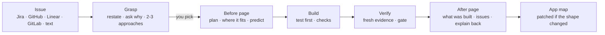

# grasp

Build it, and grasp it. A skill for coding agents that works one issue from any tracker so the
people who own the code understand it **before** it is built and **after**, not just that the
tests pass.



Every issue leaves one short page (Notion by default, Markdown in the repo otherwise) with a
diagram, the plan, what was built, what went wrong, how to check it, and an explain-back
question with the answer folded away. One app map page explains the whole app and is patched as
issues change it. Why it is shaped this way: [docs/research](docs/research/README.md).

## Install

**Claude Code plugin** (the repository is private, so git on your machine must be able to clone
it over SSH or with a stored HTTPS credential):

```
/plugin marketplace add junrillg/grasp
/plugin install grasp@grasp
```

Run it as `/grasp:grasp ISSUE`. Update with `/plugin marketplace update grasp`.

**Any agent, by link** (Claude Code, Codex, Cursor, Gemini CLI):

```bash
git clone git@github.com:junrillg/grasp.git ~/Projects/grasp
~/Projects/grasp/install.sh                    # links into ~/.claude/skills and ~/.agents/skills
~/Projects/grasp/install.sh --project ~/code/app   # or one project only
```

Run it as `/grasp ISSUE`. `git pull` updates it. `./install.sh --uninstall` removes it.

**Trackers and notebook.** Connect whatever you use: `gh` for GitHub, the Atlassian MCP server
for Jira, the Linear MCP server, `glab` for GitLab, or a project's own wrapper script. Connect
the Notion MCP server for Notion pages; without it, pages go to `docs/grasp/`. The first run in
a repository asks what it cannot detect and saves `.grasp.md`.

## Use

```
/grasp help
/grasp PROJ-123 --plan          understand and plan only: no code, no writes
/grasp #42                      full run on a GitHub issue
/grasp "add CSV export to the report page" --notebook markdown
/grasp verify PROJ-123          prove an existing fix works, fill the after page
/grasp map                      map the whole app
```

## What is inside

```
skills/grasp/SKILL.md            the workflow (the router)
skills/grasp/references/         one file per step, loaded only when that step runs
skills/grasp/templates/          issue page, app map, .grasp.md
docs/research/                   the evidence behind the design
install.sh                       link or copy into each agent's skills folder
```
