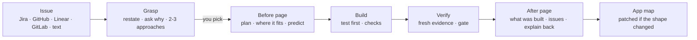
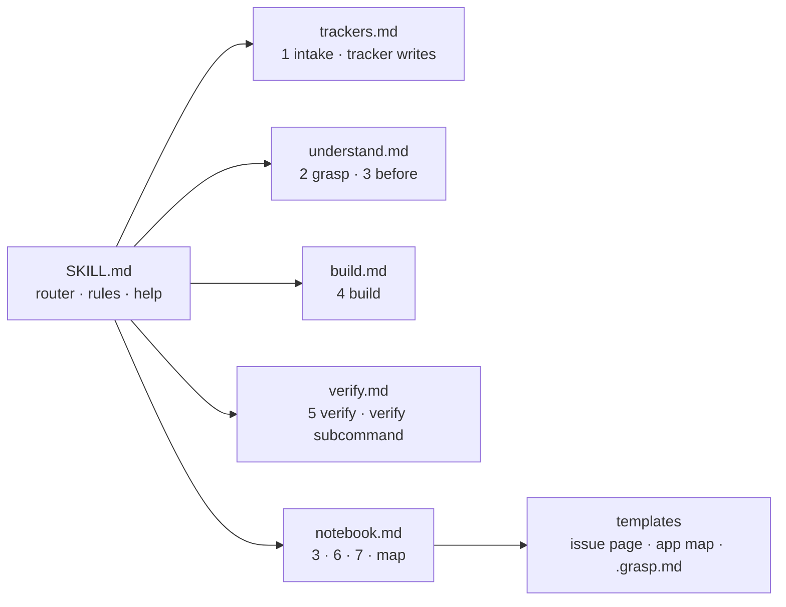

<p align="center">
  
</p>

<h1 align="center">grasp</h1>

<p align="center"><b>Build it, and grasp it.</b></p>

<p align="center">
  A skill for coding agents that works one issue from any tracker so the people who own the code
  understand it <b>before</b> it is built and <b>after</b>, not just that the tests pass.
</p>

<p align="center">
  <a href="#quick-start">Quick start</a> ·
  <a href="#what-a-run-looks-like">What a run looks like</a> ·
  <a href="#how-it-is-built">How it is built</a> ·
  <a href="docs/research/README.md">Research</a>
</p>

<p align="center">
  <a href=".claude-plugin/plugin.json"></a>
  <a href="#quick-start"></a>
</p>

## What a run looks like



This is the default flow, as printed by `/grasp help`:

```text
BY DEFAULT
  1 Intake    read the issue, comments and attachments (read only)
  2 Grasp     restate it, ask what is unclear one question at a time, show 2-3 approaches
              with a recommendation, and wait for your pick
  3 Before    write the "before" half of the issue's learning page (what, why, where it
              fits, the plan, risks) and ask you one prediction question
  4 Build     branch, test first, smallest change, the project's own checks
  5 Verify    fresh evidence only: checks, the test failing without the fix, the behaviour seen
  6 After     write the "after" half (what was built, plan vs actual, issues, how to check)
              and ask you one explain-back question
  7 Close     report; patch the app map if the issue changed how the app is put together
```

## What it does

| Capability | What happens |
| --- | --- |
| **Understands first** | Restates the ask, asks why when the issue doesn't say, asks one question at a time and lays out two or three approaches. No code until you pick one. |
| **Any tracker** | Jira, GitHub Issues, Linear, GitLab, a `.md` file or plain quoted text, all read through one intake contract. |
| **Builds test-first** | Branch per project convention, failing test first, smallest change, the project's own checks. Asks before any push, pull request or tracker write. |
| **Verifies with evidence** | "Verified" means a check ran green in this run and its result is quoted. `verify` proves an existing fix without touching code. |
| **Leaves a learning page** | One short page per issue in the repository's root `docs/` (Obsidian-compatible Markdown, listed in the docs router), or in Notion on request: a diagram, the plan, what was built, what went wrong, how to check, and an explain-back question with the answer folded away. |
| **Reviews and resolves pull requests** | `review PR` checks a pull request against its issue and the project's written rules and reports verified findings; `resolve PR` works the review threads in one new commit. Both update the issue page so it says what the code does now. |
| **Keeps an app map** | One page that explains the whole app, patched only when an issue changes how it's put together. |

## Quick start

**Claude Code plugin.** The repository is private, so git on your machine must be able to clone
it over SSH or with a stored HTTPS credential.

```
/plugin marketplace add junrillg/grasp
/plugin install grasp@grasp
```

Run it as `/grasp:grasp ISSUE`. Update with `/plugin marketplace update grasp`.

**Any agent, by link** (Claude Code, Codex, Cursor, Gemini CLI). Needs `git` and `bash`.

```bash
git clone git@github.com:junrillg/grasp.git ~/Projects/grasp
~/Projects/grasp/install.sh                        # links into ~/.claude/skills and ~/.agents/skills
~/Projects/grasp/install.sh --project ~/code/app   # or one project only
```

The installer prints one line per folder it links, for example
`link ~/code/app/.claude/skills/grasp`. Run it as `/grasp ISSUE`; `git pull` updates it.
`--copy` copies instead of linking, and `--uninstall` removes what it installed.

**First useful run.** Plan an issue without writing any code:

```
/grasp PROJ-123 --plan
```

More examples:

```
/grasp help
/grasp #42                      full run on a GitHub issue
/grasp "add CSV export to the report page" --notebook off
/grasp verify PROJ-123          prove an existing fix works, fill the after page
/grasp review 42                review a pull request, update its issue page
/grasp resolve 42               work the review threads on your pull request
/grasp map                      map the whole app
```

**Trackers and notebook.** Connect whatever you use: `gh` for GitHub, the Atlassian MCP server
for Jira, the Linear MCP server, `glab` for GitLab, or a project's own wrapper script. Pages go to
`docs/how-it-works/` at the repository root by default, in Markdown that opens as an Obsidian
vault and renders on GitHub; the first run confirms that folder with you. Pass
`--notebook notion` (with the Notion MCP server connected) to use Notion instead. The first run in
a repository asks what it can't detect and saves `.grasp.md`.

## How it is built

grasp is plain Markdown in the open Agent Skills format: there's no runtime and nothing to
compile. `SKILL.md` is a short router, and each workflow step loads only its own reference, so
an agent reads the detail a step needs and nothing else.



| Path | What it holds |
| --- | --- |
| [`skills/grasp/SKILL.md`](skills/grasp/SKILL.md) | Arguments, help, the rules for every run and the seven-step workflow |
| [`skills/grasp/references/`](skills/grasp/references/) | One file per step, loaded only when that step runs |
| [`skills/grasp/templates/`](skills/grasp/templates/) | The issue page, the app map and the `.grasp.md` project settings |
| [`.claude-plugin/`](.claude-plugin/) | Plugin and marketplace manifests for Claude Code |
| [`install.sh`](install.sh) | Links or copies the skill into each agent's skills folder |

## Why it works this way

Every design choice traces to research notes in [docs/research](docs/research/README.md):
delegating the thinking is what loses understanding, a short spec before the build beats a long
one nobody reads, and one prediction question plus one explain-back question help memory. The
same notes list the open gaps: treat the prediction question as a cheap bet, not a proven one.

- [Learning pages](docs/research/learning-pages.md)
- [Comprehension before the build, and the app map](docs/research/comprehension-before-and-app-map.md)
- [Packaging and workflow](docs/research/packaging-and-workflow.md)

## Status

Version 0.1.0, private. There's no license file yet, so no rights are granted beyond the
repository's access settings. To change the skill, edit `skills/grasp/` and try it from a linked
install (`./install.sh --project <a test repo>`) with `/grasp <issue> --plan`.
