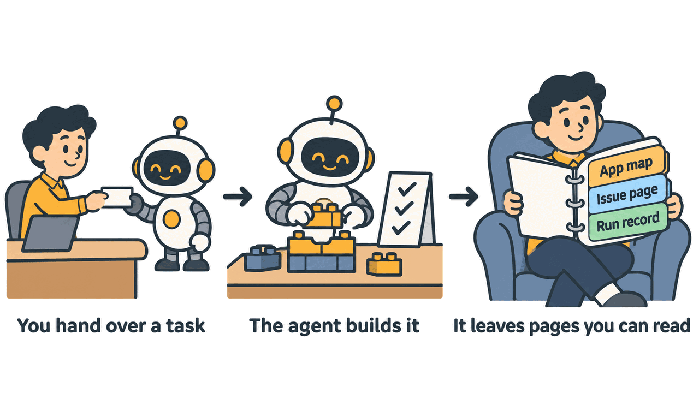
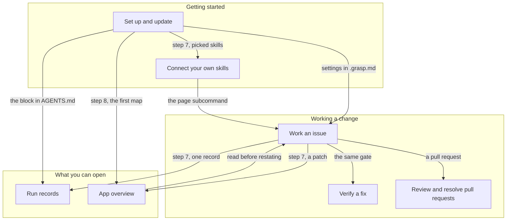
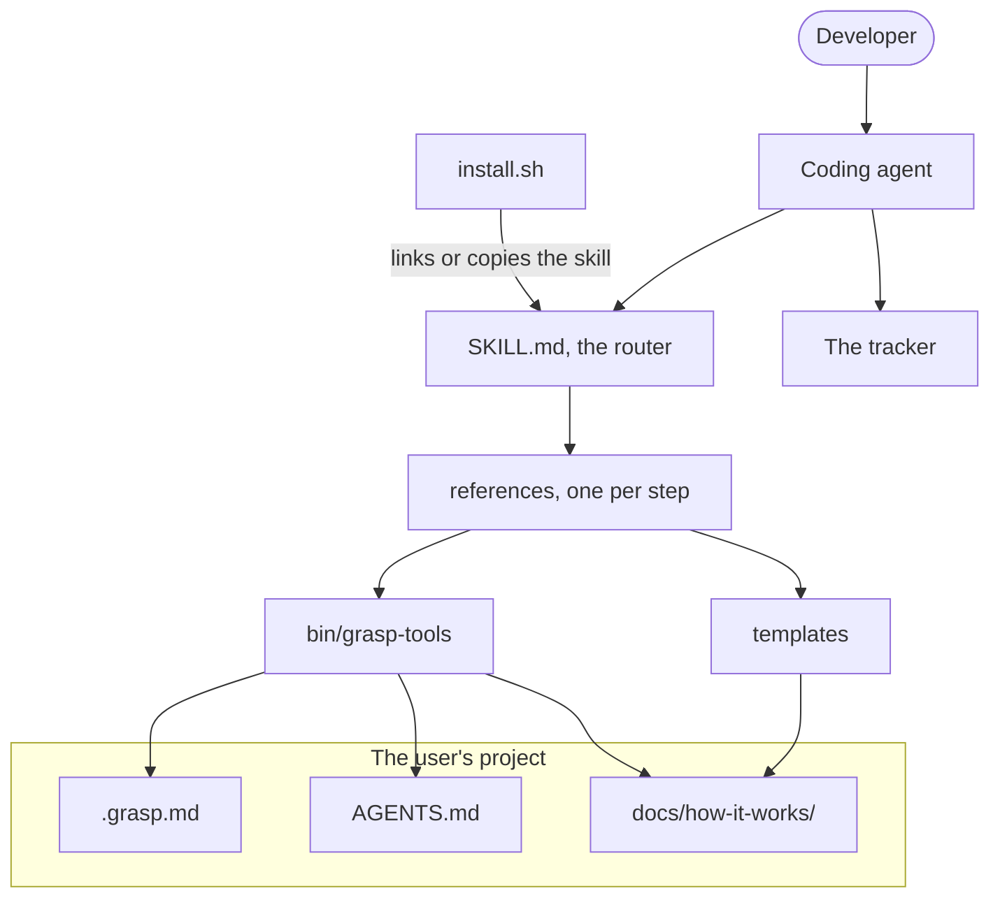
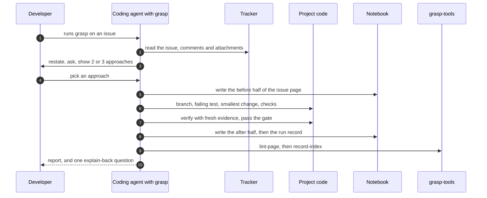

# grasp: app map

**Verified at:** `dc9a389` with uncommitted changes, 2026-11-21 · **Patched by:** nothing yet

## What it is for

grasp is a skill for coding agents (Claude Code, Codex, Cursor, Gemini CLI). Developers use it to work one issue so the people who own the code understand it before and after it is built. It also explains the app it is installed in and records every agent run (`README.md`).

## Core features

What a developer can do with grasp.

| Feature | What someone can do | Where it starts | Page |
| ------- | ------------------- | --------------- | ---- |
| Work an issue | Have an issue restated, built after your pick, verified and explained on a page | `/grasp ISSUE`, `skills/grasp/SKILL.md` | [Work an issue](features/work-an-issue.md) |
| Run records | See what each agent task asked, changed, checked and left | `/grasp record`, the block in `AGENTS.md`, `skills/grasp/references/records.md` | [Run records](features/run-records.md) |
| App overview | Read what an app is for and how its features connect | `/grasp map`, setup step 8, `skills/grasp/references/overview.md` | [App overview](features/app-overview.md) |
| Verify a fix | Prove an existing fix works, with no code change | `/grasp verify`, `skills/grasp/references/verify.md` | [Verify a fix](features/verify-a-fix.md) |
| Review and resolve pull requests | Get verified findings, or work the review threads in one commit | `/grasp review`, `/grasp resolve`, `skills/grasp/references/review.md` | [Review and resolve pull requests](features/review-and-resolve.md) |
| Connect your own skills | Have your own skills call grasp for the learning page | setup step 7, `/grasp page`, `skills/grasp/references/setup.md` | [Connect your own skills](features/connect-your-skills.md) |
| Set up and update | Install grasp, save a project's settings, pull a new version | `install.sh`, `/grasp setup`, `/grasp update`, `skills/grasp/references/setup.md` | [Set up and update](features/set-up-and-update.md) |

## Concepts

Five ideas to know before the pictures below make sense.

- **Agent skill:** a folder with a `SKILL.md` that a coding agent loads when a task matches its description; all of grasp is one skill (`skills/grasp/SKILL.md`).
- **Agent instructions file:** a Markdown file an agent reads at the start of every session; grasp puts its run-record block in `AGENTS.md` or `CLAUDE.md` (`skills/grasp/references/records.md`).
- **Agent hook:** a command the agent's program runs by itself at a fixed moment, such as when the agent stops; grasp's optional Stop hook asks for a missing run record (`skills/grasp/bin/grasp-tools`).
- **Diagrams as text (Mermaid):** a picture written as a few lines of text that the viewer draws; every grasp page uses it and `lint-page` checks it (`skills/grasp/references/notebook.md`).
- **Test-first development:** write a test that fails for the right reason, then the code that makes it pass; step 4 builds every change this way (`skills/grasp/references/build.md`).

Agent skill: instructions an agent loads only when it needs them

A skill is a folder, not a program. Its <code>SKILL.md</code> opens with a short header (front matter) holding a <code>name</code> and a <code>description</code>. The agent keeps only that header in mind and reads the rest when a task matches it or someone types <code>/grasp</code>.

grasp's header is the first lines of <code>skills/grasp/SKILL.md</code>. The body under it is the router: the rules, the seven steps and each subcommand.

The long detail lives in <code>skills/grasp/references/</code>, and a reference file is read only when its step starts, so a run never pays for text it does not use (<code>skills/grasp/references/notebook.md</code>, "Token budget").

<code>install.sh</code> links the folder into <code>~/.claude/skills</code> and <code>~/.agents/skills</code>, where Claude Code, Codex, Cursor and Gemini CLI look for skills.

<ul><li><a href="https://agentskills.io/specification">Specification - Agent Skills</a>, agentskills.io, official docs, free</li><li><a href="https://www.youtube.com/watch?v=mPjTZviv23s">Agent Skills Explained in 5 Minutes | Ep 3 of 8</a>, Visual Studio Code, YouTube, free</li></ul>

Links checked 2026-11-23.

Agent instructions file: the one place every session reads, with or without grasp

Most agent work never goes through <code>/grasp</code>, so a rule that lives only in the skill would be missed. The instructions file is read by every session.

Setup step 6 puts a short marked block there. It holds the records folder, the title and status form and the five lines, so an agent with no grasp installed can still write a record the index reads (<code>skills/grasp/bin/grasp-tools</code>, <code>record_block_text</code>).

<code>AGENTS.md</code> is the one file Codex, Cursor, Gemini CLI and Claude Code can all read. A project that has a <code>CLAUDE.md</code> needs the line <code>@AGENTS.md</code> in it; <code>grasp-tools connect CLAUDE.md import</code> adds that line.

The overview pages never go into this file. They stay in the notebook (<code>skills/grasp/references/overview.md</code>).

<ul><li><a href="https://agents.md/">AGENTS.md</a>, agents.md, the format's own site, free</li></ul>

Links checked 2026-11-23.

Agent hook: the reminder that cannot be forgotten and cannot loop

An instructions file is advice, and agents follow it less reliably late in a long session. A hook is a command the agent's program runs itself, so it does not depend on the agent remembering.

A Stop hook runs when the agent tries to finish. <code>grasp-tools record-check --hook</code> reads the hook's JSON on stdin. When files changed and no run record exists, it exits 2 with the reason on stderr and the agent is sent back once to write the record.

It lets the stop through when <code>stop_hook_active</code> is true, when <code>.grasp.md</code> is missing and on any error, so it can never loop and never blocks a project grasp is not set up in (<code>skills/grasp/references/records.md</code>, "The Stop hook").

The hook is optional and setup step 6 asks about it. This repository runs without one (<code>.grasp.md</code>, <code>stop hook: none</code>).

<ul><li><a href="https://code.claude.com/docs/en/hooks">Hooks reference</a>, Claude Code Docs, official docs, free</li></ul>

Links checked 2026-11-23.

Diagrams as text: a picture that is patched and checked like code

A Mermaid diagram is a fenced block of text that names boxes and arrows. Obsidian and GitHub draw it when the page is shown, so there is no image file to keep in step with the code.

Because it is text, a later issue changes one line of the diagram, and the change shows up in code review with the rest of the page.

<code>grasp-tools lint-page</code> reads the same text. It accepts only <code>flowchart</code>, <code>graph</code>, <code>sequenceDiagram</code>, <code>erDiagram</code> and <code>classDiagram</code>, and it reports an unclosed quote or a diagram with more than 20 boxes.

The linter does not draw the picture. A Mermaid validator or the project's doc build does that, and a report must say so when neither was run (<code>skills/grasp/references/notebook.md</code>).

<ul><li><a href="https://mermaid.js.org/intro/">About Mermaid</a>, mermaid.js.org, official docs, free</li></ul>

Links checked 2026-11-23.

Test-first development: a test seen failing first proves the change did something

A test written after the code can pass with or without the change. A test that was seen to fail and then to pass shows the change is what made the difference.

Step 4 follows that order: write the test that fails for the issue's reason, run it and watch it fail, then change the code (<code>skills/grasp/references/build.md</code>, "Implement").

Verify checks the same thing from the other side. Its control runs the new test on the code before the change, where it must fail (<code>skills/grasp/references/verify.md</code>, "Evidence").

A bug fix without a test that fails without it is not done.

<ul><li><a href="https://www.linkedin.com/learning/programming-foundations-test-driven-development-3">Programming Foundations: Test-Driven Development</a>, LinkedIn Learning, paid</li></ul>

Links checked 2026-11-23.

## How the features connect

Setup hands every feature its settings; a worked issue feeds the two things you can open.

Everything meets on three things: .grasp.md, the issue page and the run record

<ul><li><b>From Set up and update:</b> a run reads <code>.grasp.md</code>; setup steps 6, 7 and 8 start the other three (<code>skills/grasp/references/setup.md</code>).</li>
<li><b>Connect your own skills to Work an issue:</b> a connected skill calls <code>/grasp page</code>, which writes the same issue page (<code>skills/grasp/SKILL.md</code>).</li>
<li><b>Work an issue to Verify a fix:</b> step 5 and <code>verify</code> follow one file (<code>skills/grasp/references/verify.md</code>).</li>
<li><b>Work an issue to Review and resolve pull requests:</b> step 4 opens the pull request (<code>skills/grasp/references/build.md</code>) that <code>review</code> reads (<code>skills/grasp/references/review.md</code>).</li>
<li><b>Work an issue and the two page sets:</b> step 2 reads the app map (<code>skills/grasp/references/understand.md</code>); step 7 writes the record and patches the map (<code>skills/grasp/SKILL.md</code>).</li></ul>

## The pieces

Markdown the agent reads, one bash helper, and the files they act on in your project.

## One request, end to end

A developer runs `/grasp ISSUE`: the seven steps, through every piece.

## Codemap

| Area | Where | What lives there |
| ---- | ----- | ---------------- |
| Router | `skills/grasp/SKILL.md` | Arguments, help, the rules, the seven steps, each subcommand |
| Step detail | `skills/grasp/references/` | One file per step or subcommand |
| Page shapes | `skills/grasp/templates/` | Issue page, app map, feature page, workspace map, run record, `.grasp.md` |
| Exact steps | `skills/grasp/bin/grasp-tools` | connect, status, refresh, record-index, record-check, projects, check-link, lint-page |
| Install | `install.sh`, `.claude-plugin/` | Links or copies the skill; the plugin manifests |
| Tests | `tests/` | Bash tests for the helper, the installer and the help block; `tests/render/`, the Obsidian render check (`README.md`) |

## Rules that must hold

- No branch and no code until the user has picked an approach (`skills/grasp/SKILL.md`).
- The exact text is shown before any tracker write, push or pull request (`skills/grasp/SKILL.md`).
- "Verified" means a command ran green in this run (`skills/grasp/references/verify.md`).
- Every task that changes files leaves a run record (`skills/grasp/references/records.md`).
- The helper changes nothing outside its own marked block (`skills/grasp/bin/grasp-tools`).
- The overview never goes into `AGENTS.md` or `CLAUDE.md` (`skills/grasp/references/overview.md`).

## Glossary

| Word | Means |
| ---- | ----- |
| Notebook | Where the pages go: `docs/how-it-works/`, or Notion |
| Issue page | One learning page per issue: a before half and an after half |
| Run record | One small page per agent task, five fixed lines |
| The block | The marked text the helper writes into a skill or into `AGENTS.md` |
| The gate | The five conditions that must hold before a change is called done |

## Features built

See the [Features table](features/README.md): one row per issue, each linking to its page. What agents did, task by task, is in [Run records](runs/README.md).
