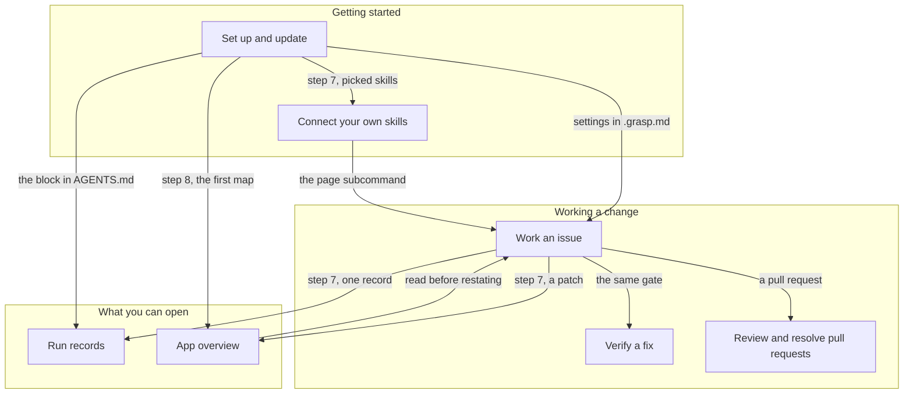
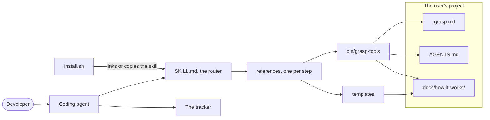
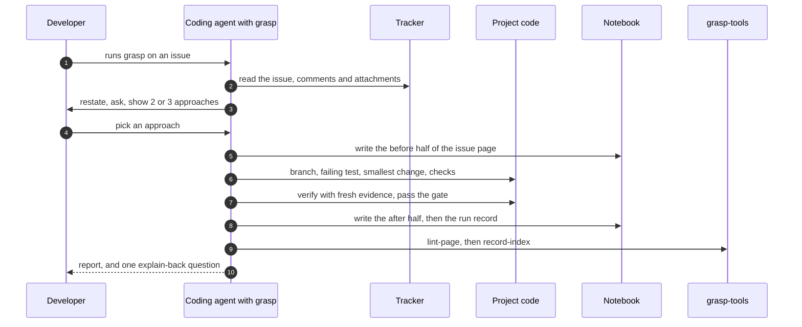

# grasp: app map

**Verified at:** `d6454c6` with uncommitted changes, 2026-11-21 · **Patched by:** nothing yet

## What it is for

grasp is a skill for coding agents (Claude Code, Codex, Cursor, Gemini CLI). Developers use it to work one issue so the people who own the code understand it before and after it is built. It also explains the app it is installed in and records every agent run (`README.md`).

## Core features

What a developer can do with grasp.

| Feature | What someone can do | Where it starts | Page |
| ------- | ------------------- | --------------- | ---- |
| Work an issue | Have an issue restated, built after your pick, verified and explained on a page | `/grasp ISSUE`, `skills/grasp/SKILL.md` | [Work an issue](features/work-an-issue.md) |
| Run records | See what each agent task asked, changed, checked and left | `/grasp record`, the block in `AGENTS.md`, `skills/grasp/references/records.md` | [Run records](features/run-records.md) |
| App overview | Read what an app is for and how its features connect | `/grasp map`, setup step 8, `skills/grasp/references/overview.md` | [App overview](features/app-overview.md) |
| Verify a fix | Prove an existing fix works, with no code change | `/grasp verify`, `skills/grasp/references/verify.md` | [Verify a fix](features/verify-a-fix.md) |
| Review and resolve pull requests | Get verified findings, or work the review threads in one commit | `/grasp review`, `/grasp resolve`, `skills/grasp/references/review.md` | [Review and resolve pull requests](features/review-and-resolve.md) |
| Connect your own skills | Have your own skills call grasp for the learning page | setup step 7, `/grasp page`, `skills/grasp/references/setup.md` | [Connect your own skills](features/connect-your-skills.md) |
| Set up and update | Install grasp, save a project's settings, pull a new version | `install.sh`, `/grasp setup`, `/grasp update`, `skills/grasp/references/setup.md` | [Set up and update](features/set-up-and-update.md) |

## How the features connect

Setup hands every feature its settings; a worked issue feeds the two things you can open.

Everything meets on three things: .grasp.md, the issue page and the run record

<ul><li><b>From Set up and update:</b> a run reads <code>.grasp.md</code>; setup steps 6, 7 and 8 start the other three (<code>skills/grasp/references/setup.md</code>).</li>
<li><b>Connect your own skills to Work an issue:</b> a connected skill calls <code>/grasp page</code>, which writes the same issue page (<code>skills/grasp/SKILL.md</code>).</li>
<li><b>Work an issue to Verify a fix:</b> step 5 and <code>verify</code> follow one file (<code>skills/grasp/references/verify.md</code>).</li>
<li><b>Work an issue to Review and resolve pull requests:</b> step 4 opens the pull request (<code>skills/grasp/references/build.md</code>) that <code>review</code> reads (<code>skills/grasp/references/review.md</code>).</li>
<li><b>Work an issue and the two page sets:</b> step 2 reads the app map (<code>skills/grasp/references/understand.md</code>); step 7 writes the record and patches the map (<code>skills/grasp/SKILL.md</code>).</li></ul>

## The pieces

Markdown the agent reads, one bash helper, and the files they act on in your project.

## One request, end to end

A developer runs `/grasp ISSUE`: the seven steps, through every piece.

## Codemap

| Area | Where | What lives there |
| ---- | ----- | ---------------- |
| Router | `skills/grasp/SKILL.md` | Arguments, help, the rules, the seven steps, each subcommand |
| Step detail | `skills/grasp/references/` | One file per step or subcommand |
| Page shapes | `skills/grasp/templates/` | Issue page, app map, feature page, workspace map, run record, `.grasp.md` |
| Exact steps | `skills/grasp/bin/grasp-tools` | connect, status, refresh, record-index, record-check, projects, check-link, lint-page |
| Install | `install.sh`, `.claude-plugin/` | Links or copies the skill; the plugin manifests |
| Tests | `tests/` | Bash tests for the helper, the installer and the help block; `tests/render/`, the Obsidian render check (`README.md`) |

## Rules that must hold

- No branch and no code until the user has picked an approach (`skills/grasp/SKILL.md`).
- The exact text is shown before any tracker write, push or pull request (`skills/grasp/SKILL.md`).
- "Verified" means a command ran green in this run (`skills/grasp/references/verify.md`).
- Every task that changes files leaves a run record (`skills/grasp/references/records.md`).
- The helper changes nothing outside its own marked block (`skills/grasp/bin/grasp-tools`).
- The overview never goes into `AGENTS.md` or `CLAUDE.md` (`skills/grasp/references/overview.md`).

## Glossary

| Word | Means |
| ---- | ----- |
| Notebook | Where the pages go: `docs/how-it-works/`, or Notion |
| Issue page | One learning page per issue: a before half and an after half |
| Run record | One small page per agent task, five fixed lines |
| The block | The marked text the helper writes into a skill or into `AGENTS.md` |
| The gate | The five conditions that must hold before a change is called done |

## Not sure yet

- Does the Stop hook work in a live session? `docs/research/README.md` says it has not been run live.

## Features built

See the [Features table](features/README.md): one row per issue, each linking to its page. What agents did, task by task, is in [Run records](runs/README.md).
