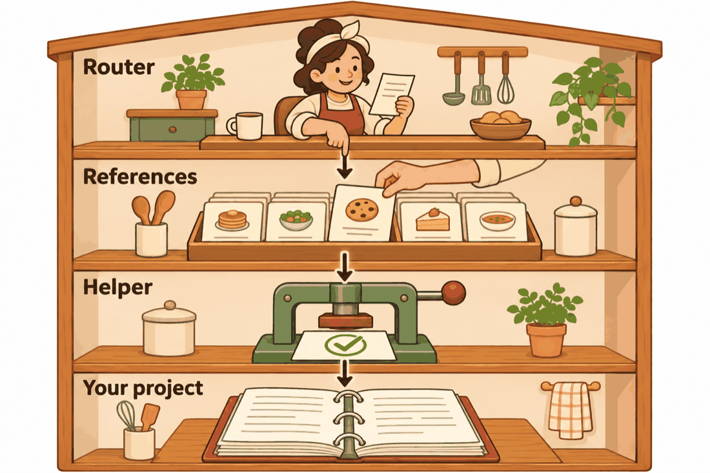
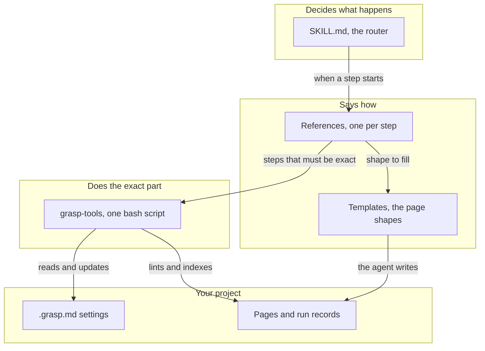
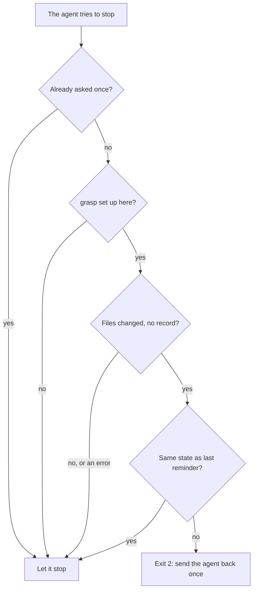

# grasp: architecture

**Verified at:** `34488a2` with uncommitted changes, 2026-11-24 · **Pieces and one request:** [app map](app-map.md#the-pieces)

**In one line:** grasp is a layered design (inferred): a short router the agent always reads, detail it reads only when a step starts, and one script for the steps that must be exact.

## The shape

Work flows down one layer at a time, and only the bottom layer is yours.

Judgement is Markdown and exactness is code, so each can change without the other

Restating an issue or explaining code needs judgement, so it is written as instructions in <code>skills/grasp/references/</code>. Replacing a marked block or counting words must come out the same every time, so it is code in <code>skills/grasp/bin/grasp-tools</code>.

The arrow that is not there: no file in the skill links outside <code>skills/grasp/</code>, because a copied install ships only that folder. <code>tests/skill-docs.sh</code> fails when one does.

## Why it is built this way

Six choices shape the rest, and each has a price.

| Choice | What it buys | What it costs | Seen in |
| ------ | ------------ | ------------- | ------- |
| Load a reference only when its step starts | A run does not pay for text it skips | A rule told in two files can drift apart (inferred) | `references/notebook.md`, "Token budget" |
| One bash script needing only bash, sed, awk and curl | Nothing to install (inferred) | Rules are heuristics, not real parsers | `bin/grasp-tools` |
| One intake note for every tracker | Later steps never care where the issue came from (inferred) | A tracker's special fields are lost (inferred) | `references/trackers.md` |
| Pages live in the repository as Markdown | Pages travel with the code and show in review | Only what Obsidian and GitHub both draw is allowed | `references/notebook.md` |
| Change only a marked block in the user's files | A refresh cannot touch their own text | A start marker with no end is an error to fix by hand (inferred) | `bin/grasp-tools`, `locate_block` |
| The Stop hook lets go on any doubt | It never loops or breaks a session | A missing record can slip through | `bin/grasp-tools`, `cmd_record_check` |

## When something fails

The Stop hook is the one place grasp can get in an agent's way, so every doubt lets the agent stop.

## How it grows

Limits the code states, and the usual answer to each.

| More of | Gives first | Seen in | The usual next step |
| ------- | ----------- | ------- | ------------------- |
| Nested projects | A repository more than eight folders deep is missed | `cmd_projects` | Let the search depth be set |
| Diagram styles | Boxes are counted by a heuristic, not a parser | `cmd_lint_page` | A real Mermaid parser |
| Languages | Words in a script other than ASCII are not counted | `cmd_lint_page` | Count bytes above 127 too |

## Concepts

Five system design ideas grasp uses.

- **Software architecture:** the few big choices that are costly to change later; here, what is Markdown and what is code.
- **Layered architecture:** each part uses only what is below it; here, router, references, helper, project.
- **Adapter pattern:** a small translator that makes different sources look the same; here, one intake note for every tracker.
- **Idempotency:** doing it twice leaves the same result as doing it once; here, connecting a skill again never adds a second block.
- **Fail open:** when a check cannot decide, let the work through; here, the Stop hook.

Software architecture: a picture of the pieces is where every design talk starts

<b>Everyday picture:</b> a house plan. You can repaint a room any day, but moving the staircase means rebuilding.

<b>Here:</b> "The pieces" on the app map is drawn one level up from files: the things that run or are stored. This page adds the rules between them.

<b>Use it when:</b> someone new must change the app. <b>Not when:</b> the app is a few files; the code is its own plan.

<ul><li><a href="https://c4model.com/diagrams/container">Container diagram</a>, the C4 model, official docs, free</li></ul>

Links checked 2026-11-24.

Layered architecture: a floor can be rebuilt while the others stay open

<b>Everyday picture:</b> a restaurant. The host takes the order, the recipe says how, the oven does the exact part. Nobody at the table talks to the oven.

<b>Here:</b> <code>skills/grasp/SKILL.md</code> names the steps, <code>references/</code> says how, and <code>bin/grasp-tools</code> does what must be exact.

<b>Use it when:</b> parts change for different reasons. <b>Not when:</b> a layer would only pass calls along.

<ul><li><a href="https://learn.microsoft.com/en-us/azure/architecture/guide/architecture-styles/n-tier">N-tier architecture style</a>, Microsoft, official docs, free</li></ul>

Links checked 2026-11-24.

Adapter pattern: one plug shape, so a new tracker changes one place

<b>Everyday picture:</b> a travel plug. The wall differs in every country; your charger does not.

<b>Here:</b> <code>references/trackers.md</code> has a reader per tracker, and "whatever the source, intake produces the same note".

<b>Use it when:</b> several sources do the same job. <b>Not when:</b> there is one source and no second in sight.

<ul><li><a href="https://refactoring.guru/design-patterns/adapter">Adapter</a>, Refactoring.Guru, reference, free</li></ul>

Links checked 2026-11-24.

Idempotency: a step that is safe to repeat needs no one to remember if it ran

<b>Everyday picture:</b> a lift button. Press it five times and the lift still comes once.

<b>Here:</b> <code>put_block</code> replaces the marked block in place when one is there and adds it when not; <code>write_if_changed</code> leaves the file alone when the bytes match.

<b>Use it when:</b> a step may be retried. <b>Not when:</b> each repeat must count, such as adding a row to a log.

<ul><li><a href="https://aws.amazon.com/builders-library/making-retries-safe-with-idempotent-APIs/">Making retries safe with idempotent APIs</a>, Amazon Builders' Library, free</li></ul>

Links checked 2026-11-24.

Fail open: right for a reminder, wrong for a lock

<b>Everyday picture:</b> a fire door that unlocks when the power goes. A bank vault must do the opposite.

<b>Here:</b> <code>cmd_record_check</code> returns 0 on anything unexpected, because a lost reminder costs less than a stuck session.

<b>Use it when:</b> blocking hurts more than missing one. <b>Not when:</b> the check guards money, data or access: there, fail closed.

<ul><li><a href="https://top10.owasp.org/2025/A10_2025-Mishandling_of_Exceptional_Conditions/">A10:2025 Mishandling of Exceptional Conditions</a>, OWASP, official docs, free</li></ul>

Links checked 2026-11-24.

## Lessons

Learn the ideas in this order; each link was checked live on 2026-11-24.

| Learn | Watch, free (YouTube) | Course, paid (LinkedIn Learning) |
| ----- | --------------------- | -------------------------------- |
| Software architecture | [Visualising software architecture with the C4 model - Simon Brown, Agile on the Beach 2019](https://www.youtube.com/watch?v=x2-rSnhpw0g), Agile on the Beach | [Software Architecture Foundations](https://www.linkedin.com/learning/software-architecture-foundations) |
| Layered architecture | [Layered Architecture Explained - The Power of Separation of Concerns (SoC)](https://www.youtube.com/watch?v=EDHw29Y-t3U), CodeOmelet | [Software Architecture: Patterns for Developers](https://www.linkedin.com/learning/software-architecture-patterns-for-developers-25635719) |
| Adapter pattern | [Adapter Design Pattern: Easy Guide for Beginners](https://www.youtube.com/watch?v=ccXWIcKHcJw), Hello Byte | [Programming Foundations: Design Patterns](https://www.linkedin.com/learning/programming-foundations-design-patterns-2) |
| Idempotency | [Idempotency in Distributed Systems: Safe Retries and Request Deduplication](https://www.youtube.com/watch?v=qqkMpwmGv7U), CodeLucky | No checked lesson yet |
| Fail open | [Fail-Open vs Fail-Closed Explained Simply \| System Design Interview with HLD Examples](https://www.youtube.com/watch?v=ITu4dLo3a68), Techdose Engineering | [DevOps Foundations: Site Reliability Engineering](https://www.linkedin.com/learning/devops-foundations-site-reliability-engineering), the field, not the idea |
