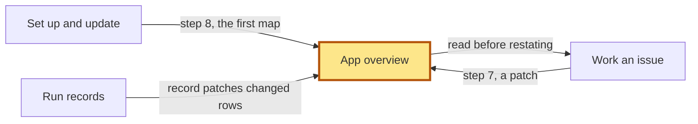
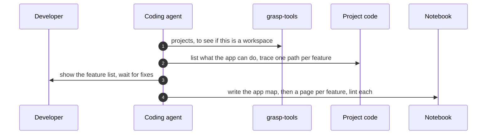

# App overview

Verified at `d6454c6` with uncommitted changes, 2026-11-21 · part of the [app map](../app-map.md)

**In one line:** grasp reads the code and writes an app map, a page per core feature and, for several projects, a workspace map.

## Where it fits

Setup writes it once; issue runs read it first and patch it after.

## How it works

Find the features from the code's own indexes, trace one path each, and write only what a file shows.

Code walkthrough: 4 steps, numbered like the diagram

<b>1.</b> Any output means a workspace, and each sub-project gets its own map (<code>skills/grasp/bin/grasp-tools</code>, <code>cmd_projects</code>)

<pre><code># cmd_projects [DIR]: sub-projects under DIR, up to three folders deep: a folder with its own
# .git (repo) or its own manifest (package). Nothing inside a nested repo is listed: that repo
# gets its own setup. DIR itself is never listed.</code></pre>

<b>2.</b> The agent searches indexes and reads only one path per feature (<code>skills/grasp/references/overview.md</code>, "Exploring the code")

<pre><code>Cheap and grounded: find the features from the code's own indexes, read only the files on one
path per feature. One subagent (Sonnet) per app; the main thread keeps only the page paths and
the feature list.</code></pre>

<b>3.</b> The feature names are the user's to fix (<code>skills/grasp/references/overview.md</code>, "Exploring the code")

<pre><code>Ask the user one thing before writing when the code can't say it: who uses the app and what for,
if the README is silent. Show the feature list and let them fix names or drop rows; it is their
vocabulary.</code></pre>

<b>4.</b> Pages are written from the traces, listed in the router and linted (<code>skills/grasp/references/setup.md</code>, "8. Overview")

<pre><code>3. Write the app map, the feature pages that earn one and, in a workspace, the workspace map.
   Create the notebook's `README.md` (the pages in reading order: the app map, Features once
   that table exists, Run records) and add the same rows to the docs router. In a workspace the
   README and the router follow "Settings in a workspace" in overview.md instead. Feature pages
   are reached from the app map, not from the router. Run `grasp-tools lint-page` on each page.</code></pre>

## Connects to

| Feature or piece | How | Seen in |
| ---------------- | --- | ------- |
| Set up and update | Step 8 writes the first overview; `map` refreshes it | `skills/grasp/references/setup.md` |
| Work an issue | Step 2 reads the pages; step 7 patches them | `skills/grasp/references/understand.md` |
| Run records | `record` patches the rows a task changed | `skills/grasp/references/records.md` |

## Rules that must hold

- Every row, connection and rule names the file it was read from (`skills/grasp/references/overview.md`).
- About 10 boxes per diagram, never more than 20 (`skills/grasp/references/overview.md`).
- The overview is never pasted into `AGENTS.md` or `CLAUDE.md` (`skills/grasp/references/overview.md`).

## Not sure yet

- Nothing counts the boxes in a diagram: `lint-page` checks only the diagram type and its quotes (`skills/grasp/bin/grasp-tools`). Should it count them too?

## Changes

| When | What changed | Page |
| ---- | ------------ | ---- |
