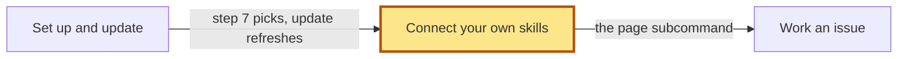
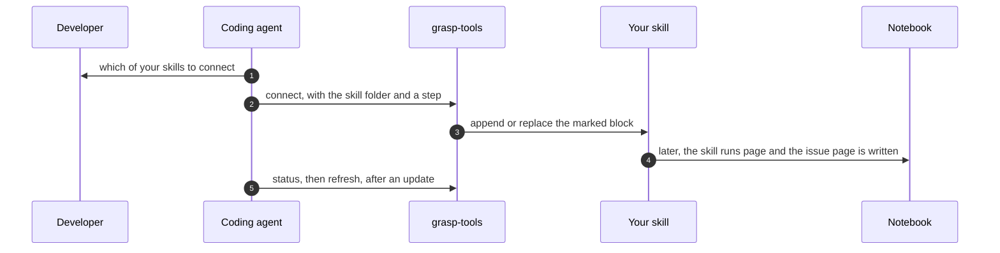

# Connect your own skills

Verified at `d6454c6` with uncommitted changes, 2026-11-21 · part of the [app map](../app-map.md)

**In one line:** Your project's own work, verify, review and resolve skills keep their job and call grasp only for the learning page.

## Where it fits

Setup picks the skills; they then feed the same issue page a grasp run writes.

## How it works

A marked block at the end of your skill tells it to call `/grasp page`; the helper owns only that block.

Code walkthrough: 5 steps, numbered like the diagram

<b>1.</b> Setup proposes a step for each project skill that overlaps (<code>skills/grasp/references/setup.md</code>, "7. Connect this project's skills")

<pre><code>   | The skill | Step |
   | --------- | ---- |
   | works or implements an issue, ticket, story or task | `work` |
   | verifies, tests or QAs a fix | `verify` |
   | reviews a pull or merge request | `review` |
   | resolves or addresses review comments | `resolve` |</code></pre>

<b>2.</b> <code>connect</code> refuses a broken block, writes the block, then lists the skill in <code>.grasp.md</code> (<code>skills/grasp/bin/grasp-tools</code>, <code>cmd_connect</code>)

<pre><code>  block_broken "$f" &amp;&amp; die 1 "${f#"$(cfg_dir)"/} has a grasp:start...
  put_block "$f" "$step"
  upsert_row "$dir" "$step"
  printf 'connected %s %s\n' "$dir" "$step"</code></pre>

<b>3.</b> The block is seven lines between two markers (<code>skills/grasp/bin/grasp-tools</code>, <code>block_text</code>)

<pre><code>    "&lt;!-- grasp:start b=$BLOCK_FORMAT v=$v step=$step -->" "$e" \
    "## Learning page (grasp)" "$e" \
    "When this skill has finished its own work, run grasp's \`page\...
    "pull request with \`--step $step\` (\`/grasp page &lt;issue or PR...
    "when grasp is installed as a plugin), so the issue's learning...
    "Skip this if grasp is not installed." "$e" \
    "&lt;!-- grasp:end -->" "$e"</code></pre>

<b>4.</b> <code>page</code> decides which half to write from the state of the work (<code>skills/grasp/SKILL.md</code>, "page subcommand")

<pre><code>2. Decide the half from state, never from `--step` alone. No diff a...
   and no pull request: the before half (step 3, without the approa...
   the calling skill made, or the issue). Otherwise the after half...
   half first if the page has none.</code></pre>

<b>5.</b> <code>refresh</code> rewrites stale blocks and leaves good, missing and broken ones alone (<code>skills/grasp/bin/grasp-tools</code>, <code>cmd_refresh</code>)

<pre><code>    case $st in
      ok) ;;
      missing|broken) printf '%s %s\n' "$st" "$skill" >&amp;2; bad=1 ;;
      *) put_block "$(target_file "$skill" "$step")" "$step"; upser...
    esac</code></pre>

## Concepts

One idea of its own. Explained on the app map: [Concepts](../app-map.md#concepts). Agent skill and the agent instructions file apply here.

- **Marked block:** a stretch of text between a start marker and an end marker that a tool owns inside a file someone else wrote; `connect` writes one at the end of your skill (`skills/grasp/bin/grasp-tools`).

Marked block: two markers let the helper rewrite its own lines and never yours

Your skill file is yours, yet grasp has to add a few lines to it and update them later. Two HTML comments, <code>&lt;!-- grasp:start ... --></code> and <code>&lt;!-- grasp:end --></code>, fence those lines off.

Running <code>connect</code> twice is safe. With no block it appends one; with a block it replaces only the lines from the start marker to the end marker (<code>put_block</code>).

The start marker carries the block format and the step. <code>status</code> also compares the lines between the markers with what this grasp would write, and calls a block that differs stale; <code>refresh</code> rewrites only those (<code>state_of</code>).

A start marker with no end marker after it is broken. The helper refuses to write there until a person fixes it by hand.

<ul><li><a href="https://docs.ansible.com/projects/ansible/latest/collections/ansible/builtin/blockinfile_module.html">ansible.builtin.blockinfile module – Insert/update/remove a text block surrounded by marker lines</a>, Ansible Community Documentation, the docs of another tool built on the same idea, free</li></ul>

Links checked 2026-11-23.

## Connects to

| Feature or piece | How | Seen in |
| ---------------- | --- | ------- |
| Set up and update | Step 7 picks the skills; update runs `status`, then `refresh` | `skills/grasp/references/setup.md` |
| Work an issue | `page` writes the same issue page as steps 3 and 6 | `skills/grasp/SKILL.md` |
| Run records | Its block in `AGENTS.md` is connected the same way, as step `record` | `skills/grasp/bin/grasp-tools` |

## Rules that must hold

- grasp never edits a skill outside its block (`skills/grasp/bin/grasp-tools`).
- `page` writes the page and nothing else (`skills/grasp/SKILL.md`).
- Only the project's own skills are scanned (`skills/grasp/references/setup.md`).

## Changes

| When | What changed | Page |
| ---- | ------------ | ---- |
