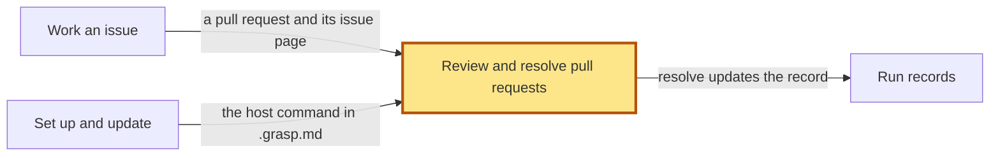
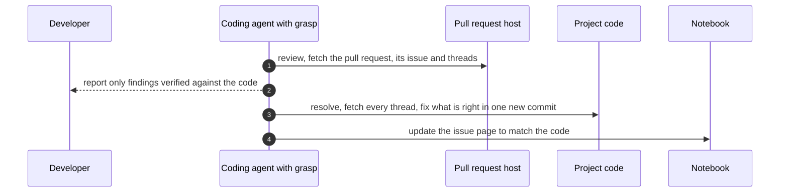

# Review and resolve pull requests

Verified at `d6454c6` with uncommitted changes, 2026-11-21 · part of the [app map](../app-map.md)

**In one line:** Review a pull request against its issue and the project's rules, or work its review threads in one new commit; both update the issue page.

## Where it fits

It picks up the pull request a worked issue opened.

## How it works

Every finding is checked against the code before it is reported or fixed; nothing is posted without a yes.

Code walkthrough: 4 steps, numbered like the diagram

<b>1.</b> <code>review</code> reads everything and changes nothing on the host (<code>skills/grasp/references/review.md</code>, "review PR")

<pre><code>## `review PR`
Read only on the host unless the user asks to post.
1. **Fetch.** The pull request's title, body, head commit, base branch, checks, changed files and
   diff, plus existing reviews and threads. Find the issue key in the title or branch name and
   read the issue (step 1 of SKILL.md). No key: say "issue not read" and go on without it.</code></pre>

<b>2.</b> The report holds verified findings with file and line (<code>skills/grasp/SKILL.md</code>, the help block)

<pre><code>  review PR         review against the issue and the project's standard, verified findings
                    with file and line, then write or update the issue page. Posts only
                    with --post, after you approve the exact text.</code></pre>

<b>3.</b> <code>resolve</code> reads each thread word for word before it fixes anything (<code>skills/grasp/references/review.md</code>, "resolve PR")

<pre><code>## `resolve PR`
The pull request is the user's own (or they asked to work it).
1. **Fetch every unresolved thread verbatim** in the main thread; never ask a subagent to
   summarise review comments. Also read review bodies and conversation comments. Stop if the
   pull request is not open. Ask before resolving threads on someone else's pull request.</code></pre>

<b>4.</b> The page says what the code does at the head commit (<code>skills/grasp/references/review.md</code>, "The issue page")

<pre><code>- Describe only what the code does at the head commit; mark what the issue asks for but the diff
  does not build as "not built yet".
- Where the page change is committed:
  - docs in a separate repository (`docs repo` in `.grasp.md`, such as a workspace wrapper):
    commit and push it there, never in the product pull request;</code></pre>

## Connects to

| Feature or piece | How | Seen in |
| ---------------- | --- | ------- |
| Work an issue | Reads the issue as step 1 does; updates the same issue page | `skills/grasp/references/review.md` |
| Run records | `resolve` updates the record; `review` writes none | `skills/grasp/references/records.md` |
| Set up and update | The host command comes from `.grasp.md` | `skills/grasp/templates/grasp-config.md` |

## Rules that must hold

- `review` posts nothing without `--post` and a yes (`skills/grasp/references/review.md`).
- `resolve` makes one new commit; it never amends or force-pushes (`skills/grasp/references/review.md`).
- An open finding is a visible warning on the issue page, never folded (`skills/grasp/references/review.md`).

## Changes

| When | What changed | Page |
| ---- | ------------ | ---- |
