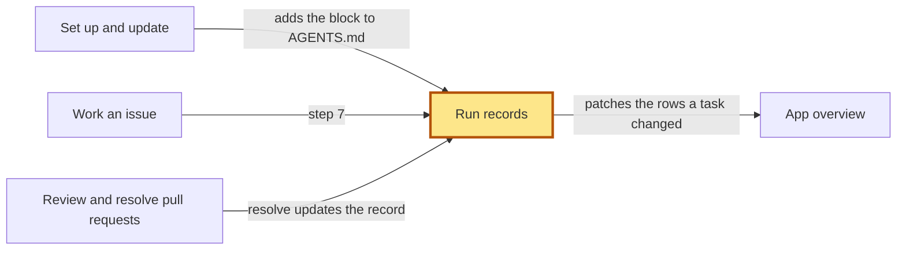
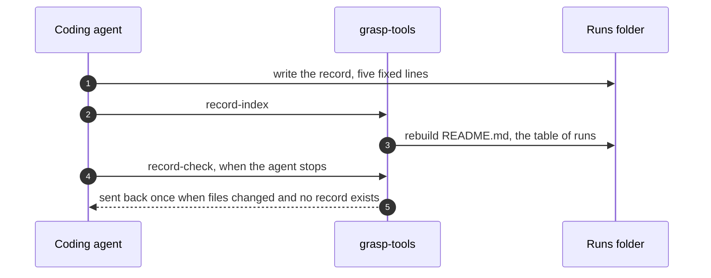

# Run records

Verified at `dc9a389` with uncommitted changes, 2026-11-21 · part of the [app map](../app-map.md)

**In one line:** Every agent task that changed files leaves a five-line record, and one table lists them all, newest first.

## Where it fits

Setup switches it on; every run that changes files writes to it.

## How it works

A block in `AGENTS.md` asks for the record, a command builds the table, and a check catches a missing one.

Code walkthrough: 5 steps, numbered like the diagram

<b>1.</b> The block spells out the five lines, so an agent without grasp can write them (<code>skills/grasp/bin/grasp-tools</code>, <code>record_block_text</code>)

<pre><code>    "exactly these five lines, one short plain sentence each:" "$e" \
    "- **Asked:** the request." "$e" \
    "- **Changed:** what behaves differently now." "$e" \
    "- **Checked:** the command you ran and its result line, or \"n...
    "- **Problems:** what failed, was worked around or is uncertain...
    "- **Next:** what a person should do or decide next, or \"nothi...</code></pre>

<b>2.</b> <code>/grasp record</code> patches the task's record or creates one, then rebuilds the index (<code>skills/grasp/references/records.md</code>, "/grasp record")

<pre><code>3. Find an existing record for the same task (its status line names...
   it if there is one; otherwise create `YYYY-MM-DD-short-name.md`...
   in quotes is the short name; without one, name it after what cha...
4. Write it in the template's shape. Link the pull request and the...
5. Run `grasp-tools lint-page FILE`, then `grasp-tools record-index`.</code></pre>

<b>3.</b> Each record becomes one table row, read from its title, status, Changed and Problems lines (<code>skills/grasp/bin/grasp-tools</code>, <code>cmd_record_index</code>)

<pre><code>      END {
        date = (file ~ /^[0-9][0-9][0-9][0-9]-[0-9][0-9]-[0-9][0-9]...
        if (title == "") { title = file; sub(/\.md$/, "", title) }
        link = file; gsub(/ /, "%20", link); gsub(/\(/, "%28", link...
        title = cell(title); gsub(/\[/, "\\[", title); gsub(/\]/, "...
        printf "| %s | [%s](%s) | %s | %s | %s |\n", date, title, l...
      }</code></pre>

<b>4.</b> The check looks at uncommitted changes plus this branch's commits (<code>skills/grasp/bin/grasp-tools</code>, <code>usage</code>)

<pre><code>  record-check [--base REF] [--hook]
                           exit 1 when files changed and no run rec...
                           uncommitted changes plus commits since R...
                           branch left the integration branch, else...
                           --hook: for an agent's Stop hook. Reads...
                           blocks once with exit 2 and the reason o...</code></pre>

<b>5.</b> As a Stop hook it reminds once and can never loop (<code>skills/grasp/references/records.md</code>, "The Stop hook")

<pre><code>`grasp-tools record-check --hook` is built for it. It reads the hoo...
stop through when `stop_hook_active` is true (so it can never loop)...
and on any error, a bad argument included; otherwise it exits 2 wit...
reminds once per state, not once per turn: after a reminder it stay...
the changed files change again, so a session that only answers ques...
left dirty hears it one time. It proves a record exists, not that t...</code></pre>

## Concepts

Explained on the app map: [Concepts](../app-map.md#concepts). The agent instructions file and the agent hook apply here.

## Connects to

| Feature or piece | How | Seen in |
| ---------------- | --- | ------- |
| Set up and update | Step 6 adds the block; update refreshes it | `skills/grasp/references/setup.md` |
| Work an issue | Step 7 writes the record, also on failure | `skills/grasp/SKILL.md` |
| Review and resolve pull requests | `resolve` updates the task's record | `skills/grasp/references/review.md` |
| App overview | `record` patches the map rows a task changed | `skills/grasp/references/records.md` |

## Rules that must hold

- One file per task; the table is built, never edited by hand (`skills/grasp/references/records.md`).
- A record says only what happened in this run (`skills/grasp/references/records.md`).
- The Stop hook never blocks a project that has no `.grasp.md` (`skills/grasp/bin/grasp-tools`).

## Not sure yet

- Does the Stop hook work in a live agent session? `docs/research/README.md` says it has not been run live.

## Changes

| When | What changed | Page |
| ---- | ------------ | ---- |
