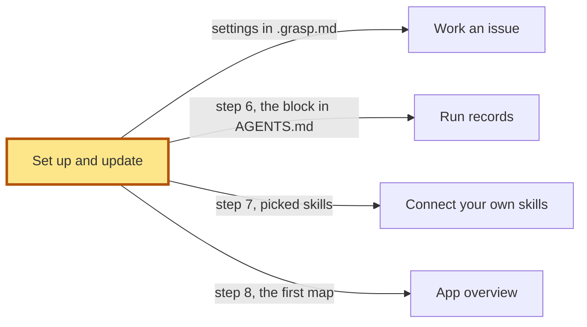
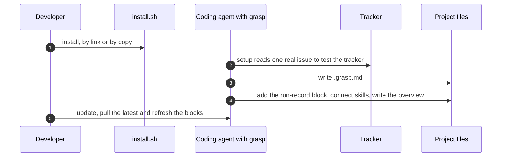

# Set up and update

Verified at `d6454c6` with uncommitted changes, 2026-11-21 · part of the [app map](../app-map.md)

**In one line:** Install grasp, run `setup` to save a project's settings, switch on run records and write the overview, and run `update` for a new version.

## Where it fits

Everything else starts from what setup saves and writes.

## How it works

`install.sh` puts the skill where agents look; `setup` asks one question at a time and saves the answers.

Code walkthrough: 5 steps, numbered like the diagram

<b>1.</b> The installer links the skill into each skills folder, or copies it and notes where from (<code>install.sh</code>)

<pre><code>  if [ "$mode" = copy ]; then
    cp -R "$src" "$dest"
    printf '%s\n' "$repo" > "$dest/.source"   # lets /grasp update...
  else
    ln -s "$src" "$dest"
  fi
  echo "$mode $dest"</code></pre>

<b>2.</b> A tracker counts as working only after a live read (<code>skills/grasp/references/setup.md</code>, "2. Tracker test")

<pre><code>Ask for one real issue key or URL. Read it with the chosen reader a...
back, in a few lines: title, the first lines of the body, the comme...
comment's author, and one attachment opened (or "no attachments")....
what they see in the tracker.</code></pre>

<b>3.</b> The answers go into one settings file (<code>skills/grasp/templates/grasp-config.md</code>)

<pre><code>## Tracker
- type: {jira | github | clickup | linear | gitlab | azure-devops |...
- reader: {e.g. "Atlassian MCP", "gh", "ClickUp MCP", "az boards",...
- project or repo: {e.g. PROJ, owner/repo, ClickUp space or list}</code></pre>

<b>4.</b> Steps 6 to 8 write into the project (<code>skills/grasp/references/setup.md</code>, the step table)

<pre><code>| 6 Run records | which instructions file, Stop hook yes/no | the b...
| 7 Connect skills | which of the project's skills | the block in e...
| 8 Overview | to confirm the feature list | the app map, feature p...</code></pre>

<b>5.</b> <code>update</code> first works out how grasp was installed; this is the link case (<code>skills/grasp/references/setup.md</code>, "/grasp update")

<pre><code>   - `&lt;skill dir>` is a symlink whose target is `skills/grasp` insi...
     `install.sh` (a link install): run `git -C &lt;that checkout> pul...
     and new `grasp-tools version`. A pull that isn't a fast-forwar...</code></pre>

## Concepts

One idea of its own. Explained on the app map: [Concepts](../app-map.md#concepts). Agent skill, the agent instructions file and the agent hook apply here.

- **Symbolic link:** a small file that only points at another folder, so both paths show the same content; the default install links the skill and does not copy it (`install.sh`).

Symbolic link: one checkout serves every agent, so an update is one git pull

A copy goes stale: the skill would sit in two skills folders, and a new version would have to be copied into each. A link holds no content, only the path of the real folder.

<code>install.sh</code> runs <code>ln -s</code> so that <code>~/.claude/skills/grasp</code> and <code>~/.agents/skills/grasp</code> both point at <code>skills/grasp</code> in the checkout. Every agent reads the same files.

That is why <code>/grasp update</code> on a link install is one <code>git pull --ff-only</code> in the checkout: the links already point at the new files.

With <code>--copy</code> there is no link. The installer writes the checkout's path into a <code>.source</code> file inside the copy, and <code>update</code> copies again from there.

<ul><li><a href="https://www.gnu.org/software/coreutils/manual/html_node/ln-invocation.html">ln invocation (GNU Coreutils 9.12)</a>, gnu.org, official docs, free</li><li><a href="https://www.youtube.com/watch?v=zfSa-PEU3h4">Linux Crash Course - Symbolic Links</a>, Learn Linux TV, YouTube, free</li></ul>

Links checked 2026-11-23.

## Connects to

| Feature or piece | How | Seen in |
| ---------------- | --- | ------- |
| Work an issue | A run with no `.grasp.md` runs setup first | `skills/grasp/SKILL.md` |
| Run records | Step 6 adds the block and offers the Stop hook | `skills/grasp/references/setup.md` |
| Connect your own skills | Step 7 connects them; `update` refreshes them | `skills/grasp/references/setup.md` |
| App overview | Step 8 writes the pages | `skills/grasp/references/setup.md` |

## Rules that must hold

- Setup never asks for, handles or prints a token (`skills/grasp/references/setup.md`).
- The installer never replaces a folder it did not copy (`install.sh`).
- `update` never pulls a repository it did not identify as grasp's (`skills/grasp/references/setup.md`).

## Changes

| When | What changed | Page |
| ---- | ------------ | ---- |
