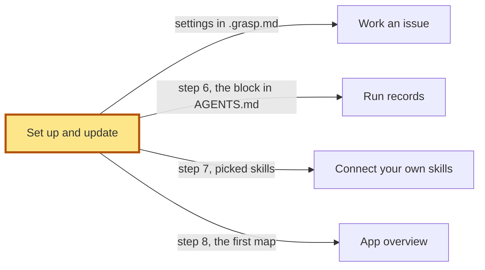
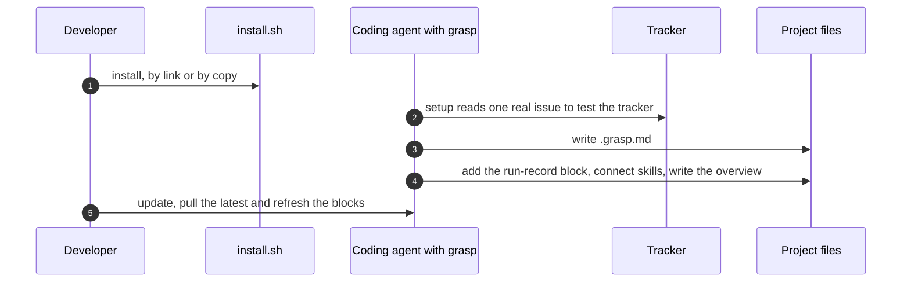

# Set up and update

Verified at `d6454c6` with uncommitted changes, 2026-11-21 · part of the [app map](../app-map.md)

**In one line:** Install grasp, run `setup` to save a project's settings, switch on run records and write the overview, and run `update` for a new version.

## Where it fits

Everything else starts from what setup saves and writes.

## How it works

`install.sh` puts the skill where agents look; `setup` asks one question at a time and saves the answers.

Code walkthrough: 5 steps, numbered like the diagram

<b>1.</b> The installer links the skill into each skills folder, or copies it and notes where from (<code>install.sh</code>)

<pre><code>  if [ "$mode" = copy ]; then
    cp -R "$src" "$dest"
    printf '%s\n' "$repo" > "$dest/.source"   # lets /grasp update re-copy from here
  else
    ln -s "$src" "$dest"
  fi
  echo "$mode $dest"</code></pre>

<b>2.</b> A tracker counts as working only after a live read (<code>skills/grasp/references/setup.md</code>, "2. Tracker test")

<pre><code>Ask for one real issue key or URL. Read it with the chosen reader and show the user what came
back, in a few lines: title, the first lines of the body, the comment count with the newest
comment's author, and one attachment opened (or "no attachments"). Ask whether that matches
what they see in the tracker.</code></pre>

<b>3.</b> The answers go into one settings file (<code>skills/grasp/templates/grasp-config.md</code>)

<pre><code>## Tracker
- type: {jira | github | clickup | linear | gitlab | azure-devops | other | none}
- reader: {e.g. "Atlassian MCP", "gh", "ClickUp MCP", "az boards", "bin/tracker" (a project wrapper)}
- project or repo: {e.g. PROJ, owner/repo, ClickUp space or list}</code></pre>

<b>4.</b> Steps 6 to 8 write into the project (<code>skills/grasp/references/setup.md</code>, the step table)

<pre><code>| 6 Run records | which instructions file, Stop hook yes/no | the block in `AGENTS.md` or `CLAUDE.md`, the `runs/` folder |
| 7 Connect skills | which of the project's skills | the block in each picked skill |
| 8 Overview | to confirm the feature list | the app map, feature pages, the workspace map |</code></pre>

<b>5.</b> <code>update</code> first works out how grasp was installed; this is the link case (<code>skills/grasp/references/setup.md</code>, "/grasp update")

<pre><code>   - `&lt;skill dir>` is a symlink whose target is `skills/grasp` inside a checkout that also holds
     `install.sh` (a link install): run `git -C &lt;that checkout> pull --ff-only` and report the old
     and new `grasp-tools version`. A pull that isn't a fast-forward: stop and show git's message.</code></pre>

## Connects to

| Feature or piece | How | Seen in |
| ---------------- | --- | ------- |
| Work an issue | A run with no `.grasp.md` runs setup first | `skills/grasp/SKILL.md` |
| Run records | Step 6 adds the block and offers the Stop hook | `skills/grasp/references/setup.md` |
| Connect your own skills | Step 7 connects them; `update` refreshes them | `skills/grasp/references/setup.md` |
| App overview | Step 8 writes the pages | `skills/grasp/references/setup.md` |

## Rules that must hold

- Setup never asks for, handles or prints a token (`skills/grasp/references/setup.md`).
- The installer never replaces a folder it did not copy (`install.sh`).
- `update` never pulls a repository it did not identify as grasp's (`skills/grasp/references/setup.md`).

## Changes

| When | What changed | Page |
| ---- | ------------ | ---- |
