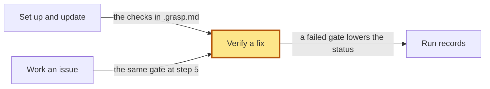
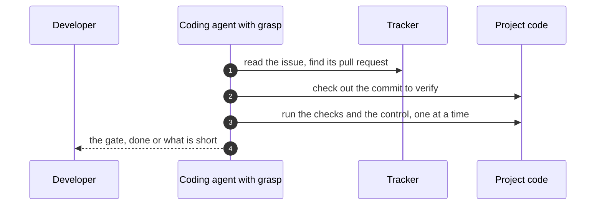

# Verify a fix

Verified at `d6454c6` with uncommitted changes, 2026-11-21 · part of the [app map](../app-map.md)

**In one line:** Prove an existing fix works with fresh evidence, without changing any code, and fill the after half of its page.

## Where it fits

It is step 5 of a full run, offered alone for a fix that already exists.

## How it works

Only what ran in this run counts: checks, a control, the behaviour, CI, then the gate.

Code walkthrough: 4 steps, numbered like the diagram

<b>1.</b> <code>verify</code> is a full run with the build left out (<code>skills/grasp/SKILL.md</code>, "verify subcommand")

<pre><code>Run steps 1, 5, 6 and 7 only. Find the pull request from the issue (branch name or title holds
the key) or take it as given. Never edit, commit, push or merge. If there is no page for the
issue yet, write the "after" half alone. Step 7's run record says what was verified or what
failed; its Changed line is "nothing".</code></pre>

<b>2.</b> Which commit is verified depends on where the fix is (<code>skills/grasp/references/verify.md</code>, "Which code")

<pre><code>| Situation | Verify | Record |
| --------- | ------ | ------ |
| Just built in this run | the branch tip | `git rev-parse HEAD` |
| Open pull request | its head commit, detached | the head SHA from the pull request |</code></pre>

<b>3.</b> The control proves the new test fails on the old code (<code>skills/grasp/references/verify.md</code>, "Evidence")

<pre><code>1. The project's checks from `.grasp.md`.
2. **The control**: the new test must fail on the code before the change
   (`git stash` the source change, or check out the parent commit in a worktree, run the one test,
   restore). When the control cannot run cleanly, skip it and say so. Do not improvise one.</code></pre>

<b>4.</b> Done is claimed only when all five hold (<code>skills/grasp/references/verify.md</code>, "The gate")

<pre><code>1. The issue's expected behaviour is understood and each criterion has a row.
2. Every check run exited 0, with the result lines shown.
3. The control failed on the old code, or the user accepted going without it.
4. The behaviour was seen correct, or the user accepted that it cannot be exercised locally.
5. CI passed for the commit verified (or there is no CI, said plainly).</code></pre>

## Connects to

| Feature or piece | How | Seen in |
| ---------------- | --- | ------- |
| Work an issue | Step 5 follows the same file; the result fills the issue page | `skills/grasp/references/verify.md` |
| Set up and update | The checks to run come from `.grasp.md` | `skills/grasp/templates/grasp-config.md` |
| Run records | A failed gate makes the record `partial` or `failed` | `skills/grasp/references/verify.md` |

## Rules that must hold

- `verify` never edits, commits, pushes or merges (`skills/grasp/SKILL.md`).
- "Verified" means a command ran green in this run (`skills/grasp/SKILL.md`).
- A control that cannot run is skipped and said so (`skills/grasp/references/verify.md`).

## Changes

| When | What changed | Page |
| ---- | ------------ | ---- |
