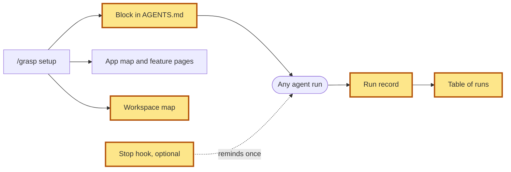

# 2026-11-21: Run records, app overview at setup, workspaces

Status: done · Claude Code · branch `main` · [design and status](../../superpowers/specs/2026-11-21-run-records-overview-workspaces-design.md)

- **Asked:** Review grasp for gaps, make every agent run record itself through `AGENTS.md`, and make setup explain the app and each sub-project.
- **Changed:** `setup` now adds a run-record block to `AGENTS.md`, writes an app map with feature pages, and covers each sub-project of a workspace.
- **Checked:** `tests/grasp-tools.sh`: `114 passed, 0 failed` (macOS, and Linux with gawk and mawk); `tests/obsidian-render.sh`: `24 pages, 34 diagrams, Reading view: all drawn`; live Claude Code and Codex sessions wrote their own records.
- **Problems:** A review found the helper could empty `AGENTS.md`, a trial found pages git ignored, and Obsidian shrank one wide diagram to unreadable; all three fixed.
- **Next:** Run the Stop hook once inside Codex, the one check the owner chose to do later; the steps are under "Open" in the design.

What was added, and what now feeds what. New parts are highlighted.

> [!WARNING]
> Not run live, by the owner's decision on 2026-11-21 to do it later: the Stop hook inside Codex. Codex wants each hook approved by a person through `/hooks`, and nothing here bypassed or forged that. What is checked: the hook command with the Stop payload Codex documents (`test_record_check_hook_reads_the_codex_stop_payload`), and the same command live in Claude Code. Reading view is now checked by `tests/obsidian-render.sh`, after the owner switched on Obsidian's command line.

> [!WARNING]
> Tried on a real workspace, read-only, pages written to a scratch folder: two repositories of about 3,000 files each. The pages came out grounded and lint clean, and the wrapper's `.gitignore` really does swallow the sub-project page folders, as the scratch trial predicted. It also showed gaps now fixed: two checkouts of one repository, a docs site listed as a project, a feature that starts in one project and ends in another.

> [!WARNING]
> Three live Claude Code runs in scratch folders wrote no record. The cause was not the block: Claude Code loads no project instructions in a folder the user has never trusted. In this repository, a live session given a real task (the `install.sh --uninstall` fix) wrote its own record, the second row of the table.

> [!WARNING]
> Obsidian rendered every diagram, but shrank the wide "How the features connect" picture until its text was unreadable. Diagrams with a `subgraph` or more than a short chain are now drawn top to bottom, which keeps the text full size. Obsidian also showed hand-wrapped paragraphs as ragged broken lines; pages are now one paragraph per line and `lint-page` reports `hard-wrap`.

> [!WARNING]
> The first trial setup wrote sub-project pages into folders the wrapper's `.gitignore` swallowed (`shop-web/` also matches `docs/how-it-works/shop-web/`). Nothing reported it. `lint-page` now prints `git-ignored` for such a page, and setup checks the folder before writing.

> [!WARNING]
> An independent review of the helper found that with an unusable `TMPDIR`, `connect` and `disconnect` truncated `AGENTS.md` and `.grasp.md` to nothing. The code path was older than this change, but this change pointed it at instruction files. Fixed: a failed temp file now stops before any write. The same review found blocks piling up after a non-UTF-8 byte and a hook that nagged every turn; both fixed. Left as they are: the limits listed under "Open" in the design.

> [!WARNING]
> The same trial produced 15 pages for about 60 lines of source: too much. The skill now writes a feature page only for a feature with a path worth tracing, gives a small project the app map alone, and explains a cross-project feature once. A second trial wrote 9 pages; still generous for a toy, right for a real project.

About 55 files touched: the helper, 16 skill files, tests and fixtures, and this repository's own notebook

<ul><li><code>skills/grasp/bin/grasp-tools</code>: <code>connect FILE record</code>, <code>connect CLAUDE.md import</code>, <code>block</code>, <code>record-index</code>, <code>record-check</code>, <code>projects</code>; <code>lint-page</code> gained dead-link, mermaid-type, mermaid-quote, hard-wrap and git-ignored, and no longer reads quoted code as Markdown; temp-file failures and non-UTF-8 bytes can no longer damage a file</li><li><code>skills/grasp/SKILL.md</code>: the <code>record</code> subcommand, setup and map rewritten, settings come only from <code>.grasp.md</code></li><li><code>skills/grasp/references/records.md</code>, <code>overview.md</code>: new</li><li><code>skills/grasp/references/setup.md</code>, <code>notebook.md</code>, <code>review.md</code>, <code>verify.md</code>, <code>build.md</code>, <code>understand.md</code>: updated</li><li><code>skills/grasp/templates/run-record.md</code>, <code>feature-page.md</code>, <code>workspace-map.md</code>: new; <code>app-map.md</code>, <code>grasp-config.md</code>: updated</li><li><code>tests/grasp-tools.sh</code>, <code>tests/skill-docs.sh</code>, <code>tests/fixtures/</code>: 59 new helper tests, 4 new doc tests</li><li><code>docs/research/run-records-and-overviews.md</code>, <code>docs/superpowers/specs/2026-11-21-run-records-overview-workspaces-design.md</code>: the research and the design</li><li><code>.grasp.md</code>, <code>AGENTS.md</code>, <code>.gitattributes</code>, <code>docs/README.md</code>, <code>docs/how-it-works/</code>: grasp set up on itself</li><li><code>README.md</code>, <code>skills/grasp/VERSION</code>, <code>.claude-plugin/plugin.json</code>: 0.3.0</li></ul>

