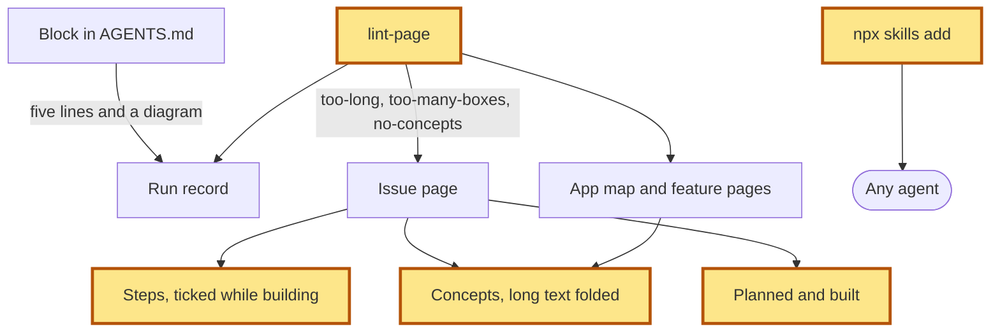

# 2026-11-23: Goal review: live steps, concepts, length limits, one-line install

Status: done · Claude Code · branch `main` · [research](../../research/prior-art-2026-11.md)

- **Asked:** Review grasp against its goals, research how others do it, close every gap, then make it public, easy to install and licensed.
- **Changed:** Pages show steps ticked during the build, concepts with long text folded, planned against built; the linter fails long pages; explain-back waits for an answer; one-line install; MIT license.
- **Checked:** `tests/grasp-tools.sh`: `133 passed, 0 failed` on macOS awk, mawk and gawk; `tests/obsidian-render.sh`: `14 pages, 19 diagrams, Reading view: all drawn`; two live runs on scratch workspaces; the one-line and plugin installs from the public repository gave 0.4.0.
- **Problems:** The skill's description was invalid YAML, so the skills CLI skipped grasp; two live runs found 38 unclear instructions. All fixed.
- **Next:** Nothing.

What each change feeds; new parts highlighted.

11 problems met, all fixed or checked

<ul><li><b>Invalid YAML in the skill header.</b> The description held <code>: </code> without quotes. Claude Code accepted it; <code>npx skills add</code> printed "YAML parse error" and skipped grasp. The description is now quoted and <code>tests/skill-docs.sh</code> pins it.</li><li><b>The skills CLI also lists the test fixtures as skills.</b> The README line passes <code>--skill grasp</code>.</li><li><b><code>install.sh --project</code> with no folder crashed</b> with "unbound variable". It now prints usage and exits 2.</li><li><b>grasp's own record broke its own limit.</b> The 2026-11-21 record had 643 visible words against 120; lint passed it. Its problem notes are now in one toggle.</li><li><b>The tests left temp folders behind.</b> One folder per suite run now, removed at exit.</li><li><b>The live run found 19 unclear instructions.</b> A fresh agent ran setup and one issue on a scratch workspace of three repositories. The page went from <code>planned</code> to <code>building</code> with step 1 ticked, then to <code>verified</code>; two illustrations were generated; every page linted clean and drew in Obsidian. Fixed after it: a small workspace has no app map (the workspace map now stands in), the control after a commit, permalinks with no remote, text issues with no key, <code>lint-page</code> measuring <code>AGENTS.md</code> as a run record, and 14 smaller ones.</li><li><b>A repository more than three folders down was missed.</b> <code>grasp-tools projects</code> now finds one up to eight deep.</li><li><b>Privacy audit before going public.</b> No secrets and no client names. The author email on every commit was personal, so history is rewritten to GitHub's private address and published to a fresh repository; the old one is kept private as an archive.</li><li><b>A second live run, on a larger workspace of two repositories.</b> It confirmed 17 of the first 19 fixes (2 situations did not arise), wrote the Obsidian vault settings, two app maps with concepts and one illustration, and held the page at <code>building</code> until the explain-back was answered with "skip". It found 19 smaller gaps, also fixed: the image tool writing its own run record, who writes the workspace map, the staleness stamp after setup's own commit, backticks inside a toggle, and 15 others. Its pages drew in Obsidian: 10 pages, 9 diagrams.</li><li><b>The plugin route.</b> <code>claude plugin marketplace add junrillg/grasp</code> and <code>claude plugin install grasp@grasp</code> installed 0.4.0 into a scratch config folder.</li><li><b>The one-line install was first checked from a local path only.</b> After the push it was run against the public repository with no credentials, into a scratch home: it installed 0.4.0 for Claude Code, Codex, Cursor and Gemini CLI.</li></ul>

About 50 files touched: the helper, 14 skill files, tests and fixtures, grasp's own pages

<ul><li><code>skills/grasp/bin/grasp-tools</code>: <code>lint-page</code> learns the page kind and reports <code>too-long</code>, <code>too-many-boxes</code>, <code>no-concepts</code>; the record block asks for one diagram; <code>check-link</code> prints the LinkedIn Learning course title</li><li><code>skills/grasp/templates/</code>: issue page gains Steps, Concepts, Planned and built; app map and feature page gain Concepts; settings gain <code>illustrations</code></li><li><code>skills/grasp/SKILL.md</code>, <code>references/</code>: the build ticks steps and sets <code>building</code>; long text is always folded; illustrations asked once at setup; update knows a skills CLI install</li><li><code>install.sh</code>, <code>README.md</code>, <code>.claude-plugin/plugin.json</code>, <code>skills/grasp/VERSION</code>: 0.4.0, the one-line install</li><li><code>tests/</code>: 18 new helper tests, 1 new doc test, 5 fixtures</li><li><code>LICENSE</code>: MIT</li><li><code>docs/how-it-works/</code>: Concepts with checked links on the app map and seven feature pages; <code>.grasp.md</code>: LinkedIn Learning yes, illustrations yes</li><li><code>docs/research/prior-art-2026-11.md</code>: the research</li></ul>

