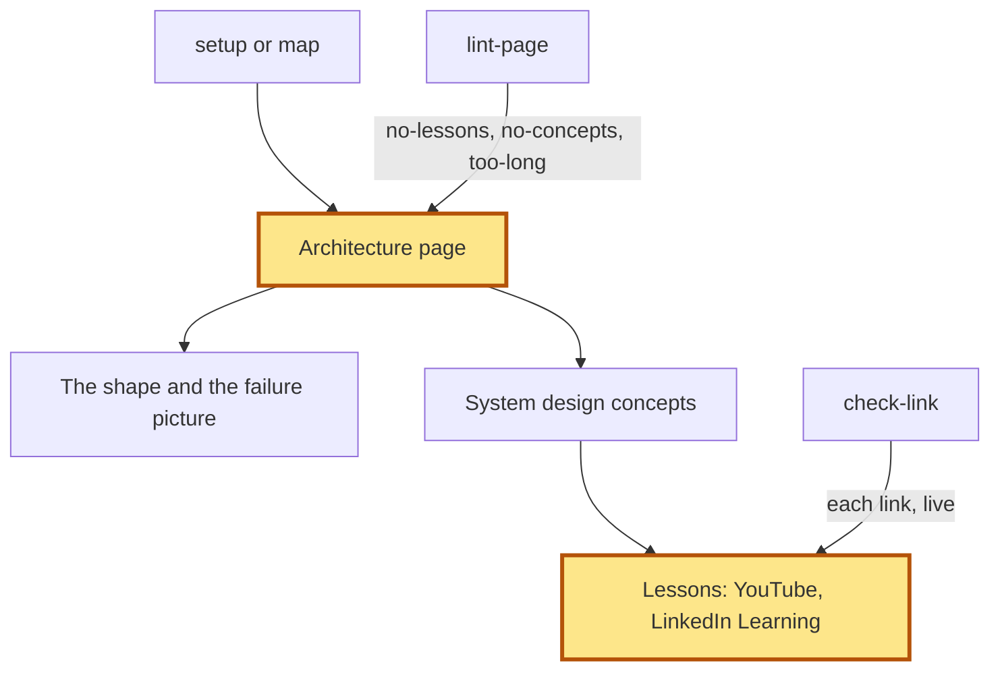

# 2026-11-24: Architecture page and system design lessons

Status: done · Claude Code · branch `main`

- **Asked:** Check whether grasp explains architecture and system design, with an illustration or diagram and LinkedIn Learning or YouTube lessons, and fill what is missing.
- **Changed:** `map` and setup now also write an architecture page: the design by name, why and at what cost, what fails, what gives first, and checked lessons; grasp has its own.
- **Checked:** `tests/grasp-tools.sh`: `134 passed, 0 failed`; `tests/skill-docs.sh`: `15 passed, 0 failed`; Obsidian drew both diagrams on the new page.
- **Problems:** The render check failed on five pages whose files did not change, and its rerun failed its own control; the page was not tried on another app.
- **Next:** Run `/grasp map` on a real app and judge its architecture page, then commit.

Where the new page comes from and what checks it; new parts highlighted.

Five problems met, two still open

<ul><li><b>The check found a gap, not a blank.</b> The app map already drew the pieces and one request, and its concepts had checked links; nothing named the architecture, gave reasons or costs, or taught system design.</li><li><b>A test failed late.</b> The app map and workspace map templates now link the architecture page, which the template test did not lay out. The test now lays it out and lints it too.</li><li><b>"Design system" could mean two things.</b> Read as system design; an app with a UI also gets a short Design system section, so both are covered.</li><li><b>Obsidian stopped drawing part way (open).</b> The first run passed its control and drew the app map, the architecture page and the changed feature page, then drew nothing on five later pages, with no errors. The second run failed its control, so its result is not used. The new run record's diagram was not drawn.</li><li><b>No LinkedIn Learning course for idempotency passed (open).</b> The page says "No checked lesson yet"; the fail-open course covers the wider field only, and says so.</li></ul>

