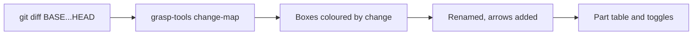

# 2026-11-26: change map and three zoom levels

Status: done · Claude Code · branch `main`

- **Asked:** Make a page about a change easy to understand at a glance, with a diagram and an illustration of how it fits the whole, and every detail kept but folded.
- **Changed:** `grasp-tools change-map` draws the code base coloured new, changed or untouched from git, and an issue page's after half now opens with it, a part-by-part table and one folded toggle per part.
- **Checked:** `tests/grasp-tools.sh`: `139 passed, 0 failed`; `tests/skill-docs.sh`: `15 passed, 0 failed`; a real run on a two-repository workspace drew 16 boxes.
- **Problems:** The map counts folders, not jobs: a person still renames the boxes and draws the arrows.
- **Next:** Use it on the next issue page and judge whether the part names need a helper.

