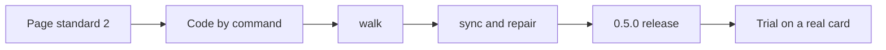

# 2026-11-26: understanding-first build

Status: partial · Claude Code · branch `main`

- **Asked:** Build the understanding-first design: a new page standard and the `explain`, `walk`, `sync` and `repair` subcommands, released as grasp 0.5.0.
- **Changed:** Issue pages follow standard 2 with a code page, `walk`, `sync` and `repair` exist, and the version, README and research index say so.
- **Checked:** `tests/grasp-tools.sh`: `213 passed, 0 failed`; `tests/skill-docs.sh`: `26 passed, 0 failed`; `tests/obsidian-render.sh`: `19 pages, 25 diagrams, Reading view: all drawn`, all from `main` after the merge.
- **Problems:** The trial on a real card has not run, and the render test on the fixtures folder fails on five older fixtures (three broken on purpose, two whose image is not copied) while the three new standard 2 fixtures draw.
- **Next:** Run `/grasp update` in each connected project, then the trial on one real card, then the adoption plan for the first project.

