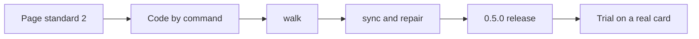

# 2026-11-26: understanding-first build

Status: partial · Claude Code · branch `feat/understanding-first`

- **Asked:** Build the understanding-first design: a new page standard and the `explain`, `walk`, `sync` and `repair` subcommands, released as grasp 0.5.0.
- **Changed:** Issue pages follow standard 2 with a code page, `walk`, `sync` and `repair` exist, and the version, README and research index say so.
- **Checked:** `tests/grasp-tools.sh`: `193 passed, 0 failed`; `tests/skill-docs.sh`: `21 passed, 0 failed`.
- **Problems:** The trial on a real card has not run; the Obsidian render test skipped once, then exited 1 because its vault points at the main checkout, not this worktree.
- **Next:** Run the trial on one real card, then the adoption plan for the first project.

