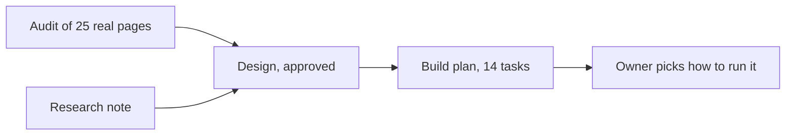

# 2026-11-26: understanding-first design

Status: partial · Claude Code · branch `main`

- **Asked:** Work out how grasp should change so a card's owner understands what an agent built, with research into how others do it.
- **Changed:** Nothing behaves differently yet: a research note, an approved design and a 14-task build plan were written for page standard 2, `walk`, `sync`, `repair` and `explain`.
- **Checked:** not checked: documents only, no tests run.
- **Problems:** One research claim about Obsidian's diagram engine was not re-checked, and nothing is committed yet.
- **Next:** Review [the plan](../../superpowers/plans/2026-11-26-understanding-first.md) and choose how to run it.

