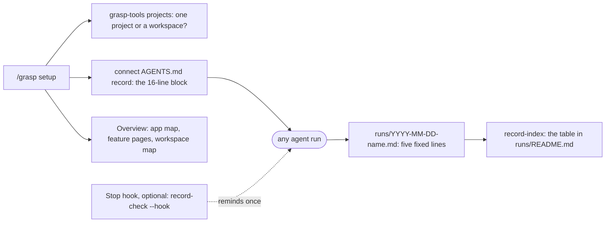

# Run records, app overview at setup, and workspaces

Date: 2026-11-21 · grasp 0.3.0 · Research: [run-records-and-overviews.md](../../research/run-records-and-overviews.md)

## Outcome

After `/grasp setup` in a project, a person who was not watching can open `docs/how-it-works/`
in Obsidian and answer two questions without reading code or a transcript:

1. **How does this app work?** What it is for, its core features, how each works, how they
   connect, the architecture. In a top folder with sub-projects: the same for each one, plus how
   the projects fit.
2. **What have the agents done?** One short record per task: asked, changed, checked, problems,
   next. For every task that changed files, including ones that never went through `/grasp`.

## Not in scope

- A hosted viewer, an Obsidian plugin or Obsidian-only syntax. Pages stay plain Markdown.
- Recording read-only sessions, or every turn of a session.
- Proving a record is true. The check proves a record exists; the block and the template tell the
  agent to write only what happened.
- Auto-installing the Stop hook. It is offered, off by default.
- Parsing workspace manifests. `grasp-tools projects` finds folders with their own `.git` or
  manifest; the agent checks that list against the manifests.

## Design in one picture

## Requirements and status

| # | Requirement | Where | Status | Evidence |
| - | ----------- | ----- | ------ | -------- |
| 1 | Setup writes a block into `AGENTS.md` or `CLAUDE.md` so every run records itself | `grasp-tools connect FILE record`, setup step 6, `references/records.md` | verified | `tests/grasp-tools.sh` record-block tests; this repository's own `AGENTS.md` |
| 2 | The block is kept current and never touches user text | reuses the marked-block code: `status`, `refresh`, `disconnect`, broken-marker refusal | verified | `test_record_folder_comes_from_config_and_goes_stale`, `test_disconnect_record_restores_file`, `test_record_broken_marker_is_refused` |
| 3 | A record is short, fixed in shape and readable in Obsidian and on GitHub | `templates/run-record.md`, `lint-page` | verified | `test_new_templates_lint_clean`, `test_record_index_is_idempotent_and_lints` |
| 4 | One table of every run, newest first, with the problems shown | `grasp-tools record-index` | verified | `test_record_index_builds_table` |
| 5 | A forgotten record is caught | `grasp-tools record-check`, optional Stop hook, optional CI | verified, and run live in Claude Code: the hook fired and the session went back and wrote the record. Not run live in Codex | 17 `test_record_check_*` tests; one live Claude Code session with the hook and no block |
| 6 | Bugs, small diffs and failed runs are recorded too | `references/records.md` "When to write one", step 7, `notebook.md` | implemented (instructions) | trial setup run, see below |
| 7 | Setup writes an overview: purpose, core features, how they connect, pieces, one traced request | setup step 8, `references/overview.md`, `templates/app-map.md`, `templates/feature-page.md` | implemented (instructions) | this repository's `docs/how-it-works/`; trial setup run |
| 8 | Claims in the overview are grounded | "Only what a file shows", "(inferred)", "Not sure yet" | implemented (instructions) | reviewed by hand on the two trial outputs |
| 9 | A top folder with sub-projects: each gets its overview, plus how they fit | `grasp-tools projects`, setup step 0, "Workspaces" in `overview.md`, `templates/workspace-map.md` | verified for detection; instructions for the rest | `test_projects_*`; trial setup run on a two-repository workspace |
| 10 | Records work when docs live in another repository (a wrapper's vault) | `run records:` may point outside; `record-check` looks in that repository | verified | `test_record_check_records_in_another_repo` |
| 11 | Help, argument-hint, references and templates agree | `tests/skill-docs.sh` | verified | 13 doc tests |
| 12 | A page that won't be kept or won't render is caught: git-ignored, a link to a missing file, an untested diagram type, an unclosed quote | `lint-page` rules `git-ignored`, `dead-link`, `mermaid-type`, `mermaid-quote` | verified | `test_lint_flags_*`; caught the first trial's ignored pages |
| 13 | The overview scales with the code and never repeats a picture | "Scale with the app" in `overview.md` | implemented (instructions) | trial 1: 15 pages, 4,300 words; trial 2 after the rule: 9 pages, 2,259 words |
| 14 | The helper never damages a user's file | temp-file failures stop before any write; bytes, not characters; a block hidden by an unclosed code fence is refused | verified | `test_unusable_tmpdir_never_empties_a_file`, `test_non_utf8_byte_does_not_duplicate_the_block`, `test_unclosed_fence_above_the_block_is_refused`, `test_read_only_file_is_reported` |
| 16 | Pages render in Obsidian and stay readable | `flowchart TB` unless a short chain; one paragraph per line (`hard-wrap`); plain sentences instead of HTML comments; quoted code lines under about 70 characters; one optional illustration on the app map | verified in Obsidian 1.15.1, Live Preview | 20 diagrams, a run record, a feature page, the table of runs, alerts and a toggle captured from the app |
| 17 | The block really makes an agent write the record | the 16-line block; `connect CLAUDE.md import` when a `CLAUDE.md` exists | verified live | Codex CLI 0.169 wrote the record from the block alone; a Claude Code 2.1.330 session in this repository wrote `runs/2026-11-21-uninstall-own-installs-only.md` after a real task |
| 15 | The Stop hook is quiet enough to leave on | reminds once per state, never on a bad argument, never twice in a row | verified for the command | `test_record_check_hook_*` |

"Implemented (instructions)" means the behaviour is Markdown an agent follows. It was exercised
by trial runs, which is evidence it can be followed, not a guarantee every agent will.

## Decisions

- **One file per task, built index.** A shared log conflicts on every merge; a built table can't
  drift and is rebuilt to settle a conflict.
- **Block in `AGENTS.md`, import line in `CLAUDE.md`.** One copy serves every agent.
- **Rows for instruction files live in "Connected skills"** with step `record`. It reuses the
  tested status and refresh code; the cost is a section name that is slightly too narrow.
- **Feature pages beside issue pages.** The app map stays one page; an issue page explains a
  change, a feature page explains how the feature works now.
- **Only `flowchart` and `sequenceDiagram`.** The two types render-tested here.

## How it was checked

- `tests/grasp-tools.sh`: 113 tests (55 before), `tests/skill-docs.sh`: 13 (9 before). Both pass
  under bash 5.3 and macOS `/bin/bash` 3.2 with BSD awk, and in a Debian container (bash 5.2,
  GNU sed) with both mawk and gawk.
- Two trial setups: a fresh agent, given only the installed skill and a scratch workspace of two
  repositories, followed `/grasp setup` literally and reported every place the text made it
  guess. Trial 1 found the git-ignored pages and about ten guess points; trial 2, after the
  fixes, was blocked by nothing.
- grasp set up on this repository: `.grasp.md`, the block in `AGENTS.md`, the app map, seven
  feature pages and the run records, all lint clean.
- A real workspace, read-only, pages written to a scratch folder: two repositories of about
  3,000 files each plus a second checkout and a docs site. Ten pages, lint clean, nothing
  written into the workspace. It confirmed the git-ignore trap on a real wrapper and added the
  rules for a duplicate checkout, a docs site, a sub-repository holding several apps, and a
  feature split across two projects.
- Rendered in Obsidian 1.15.1: every diagram and each kind of page, captured from the app. That
  is where the wide-diagram problem was found and fixed.
- Live agents, each given a small task with no mention of records: Codex wrote the record from
  the block; Claude Code with only the Stop hook was sent back and wrote it; Claude Code in this
  repository, with only the block, wrote the record for a real fix to `install.sh`.
- An independent review of the helper with reproducing commands; every high and medium finding
  is fixed and has a test.

## Open

- Run the Stop hook live in Codex once. It needs the hook approved through `/hooks` in an
  interactive session.
- Look at the pages in Obsidian's Reading view. Only Live Preview was captured: switching view
  needs a click, or Obsidian's command line, which is off in its settings.
- Claude Code loads no project instructions in a folder the user has never trusted, so a block
  in a brand-new clone does nothing until the project has been opened and trusted once.
- Known limits of the helper, left as they are: where several repositories share one run
  records folder, any new record there satisfies `record-check`; a record file whose name holds
  a double quote is not seen; `lint-page` does not check reference-style links, file names with
  parentheses, or a quoted diagram label that spans two lines; `projects` skips folders named
  `build`, `dist`, `vendor` and `target`.
