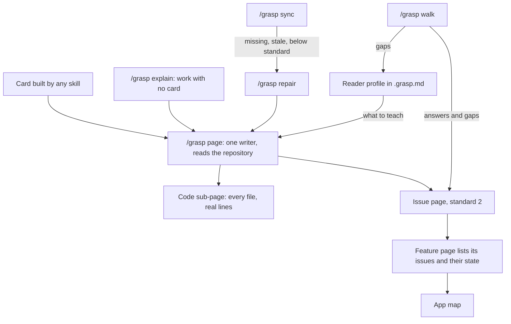

# Understanding first: one page standard, a guided walk, sync and repair

Date: 2026-11-26 · grasp 0.4.0 to 0.5.0 · Research: [understanding-first.md](../../research/understanding-first.md)

## Why

On a real project with 25 issue pages, the owner could not answer the product owner's or the
project manager's questions about most cards, because they did not understand how the cards were
implemented. The pages existed. They did not produce understanding. An audit found:

- Two writers with two rule sets. The project's card skill followed its own page rules (after half
  250 to 400 words, at most 6 files, no component diagrams, no lessons) and also carried the block
  that calls `/grasp page`.
- The writer was given the diff and never the repository, so it could not say how the change sits
  in the system.
- No page quoted the card's ask. No page listed every changed file. No page linked a lesson. One
  page of 25 had a Concepts section.
- Every explain-back answer was "pending". The `page` path, the one connected skills use, never
  asks a person.
- One card left seven or eight overlapping documents in six folders, with no place to start.

The research says a better page is not enough: understanding comes from answering questions about
the mechanism, and people who only delegate and read score lowest.

## Outcome

After a card is built, its owner can:

1. Read one page for about two minutes and tell an owner or project manager what was asked, what
   users can now do, the risk, what is not done and what needs a decision.
2. Open the folds and one sub-page and follow the implementation end to end: every changed file,
   the real lines, why it was built this way, what proves it works.
3. Run a ten minute walk that asks about the mechanism, records the answers on the page, and turns
   each gap into one checked lesson.
4. Ask at any time which pages are missing, out of date or below the standard, and have them
   repaired.

## Goals

- One page standard, one writer, used by every path that writes a page.
- Every changed file named, proven by a script.
- Code and command output on a page are pulled by command, never retyped.
- Teaching follows the reader: only ideas new to them, and lessons for gaps a walk found.
- A reading path with three levels: app map, feature page, issue page.
- Pages that say when they stopped matching the code.

## Not in scope

- Blocking a pull request or a merge on a walk or on any answer.
- Scoring or grading a person. A walk records right, gap or skipped.
- An understand-before-build gate (the person explains the approach, or writes a key piece, before
  the agent builds). Rejected for now, see Approaches.
- A hosted viewer or an Obsidian plugin. Pages stay plain Markdown.
- Replacing a project's board tooling. `sync` reads the tracker; it does not own a board map.
- Per-person reader profiles. One profile per project.

## What would make this a failure even if it works

- Pages get longer. The visible part must stay under the existing 400 word limit.
- The walk becomes a chore that is skipped every time. It is short, optional, and offered once.
- `repair` overwrites something a person wrote.
- A page states something the writer did not check.

## Approaches

| | What | Trade-off |
| --- | --- | --- |
| A | Better page only: new standard, one writer, `repair` for old pages. | Smallest. Still reading only, which the evidence ranks lowest. |
| **B, picked** | A, plus a guided walk the owner starts when ready, per issue or per feature. | About ten minutes of the owner's time per walk, more to build. Keeps unattended runs. |
| C | Understand before build: explain the approach back, write one key piece by hand, no pull request until answered. | Strongest evidence. Slows delivery and breaks unattended card runs. |

The owner picked B. A repeats today's failure with a nicer layout. C fights how the work is
shipped and can come later as a per-issue flag.

Two more choices the owner made:

- Deep detail: short facts fold on the page; the code walkthrough and the file list go to one
  sub-page so code keeps its colours. Not everything in folds (Obsidian shows no code colours or
  diagrams inside a fold), and not a folder of sub-pages per card (too many files).
- Records: the issue page is the one record for a card. A project that also wrote a separate
  implementation record per card stops doing so for card work. Old records are kept and linked.

## Design in one picture

## The page standard (standard 2)

Each issue page carries a status line: status, `Standard: 2`, its feature, the walk state, and the
commit of each project it was checked against.

Always visible, target 300 words, existing lint limit of 400 stays:

| # | Section | Holds |
| --- | --- | --- |
| 1 | In two sentences | What a user can now do, and the state of it. |
| 2 | For the owner | Five labelled lines: Asked, Users can now, Risk, Not done, Needs a decision. Asked is the card's ask in its own words, 30 words at most, a close paraphrase where the project's rules forbid quoting. A line with nothing true to say reads "none". Before and after screenshots sit here when the change is visible to a user. |
| 3 | Where it fits | The existing change map, this issue's parts highlighted. Links up to the feature page. |
| 4 | Ideas this leans on | At most 3. The first is always the design idea: the architecture pattern or system design concept the change rests on, named so the owner can say it to someone else. The others are chosen from the reader profile. One visible line each. The fold holds 3 to 5 lines tied to this code, one specific video to watch and one page to read. |
| 5 | How it works | One diagram, type chosen by the change as today, with 4 to 7 numbered steps beside it. |

Folded on the page, each fold labelled with what is inside:

| Fold | Holds |
| --- | --- |
| Why it was built this way | Each decision, the option not taken, and what the choice costs. |
| Planned and built | As today. |
| Proof it works | A table with one row per acceptance point of the card: the point, the command or check that proves it, and its real result line. Only runs made in this session or results read from the pull request's checks. Anything else reads "not run here". |
| Open and not verified | Open items, plus what went wrong and what was learned. |
| Your walk | Empty until a walk. See below. |

On one sub-page beside the page, named after it with a `-code` suffix:

- **Every changed file**, grouped by layer, one line each saying what it does in this change.
- **Code walkthrough**: one entry per "How it works" step, same numbers, real fenced code with a
  link to the exact lines at the commit.

Rules:

- Two levels only: visible, then a fold or the sub-page. No fold inside a fold.
- Small changes and bugs get a short page (sections 1, 2 and 5, Proof, and the file list on the
  page itself, no sub-page) instead of only a row on the feature page.
- Predict stays in the attended flow. Explain it back is replaced by the walk. A page with no walk
  is not a lint failure; `sync` reports it.
- Diagram types stay as lint allows today. A new type is added only after it renders in both
  Obsidian and VitePress in the render test.
- Quoted words count toward the visible limit.

What stays from today's page:

- The before half. At the pick, the attended flow writes sections 1 to 4 as planned, with Steps
  and Predict. `--plan` still stops there.
- Steps stay visible and are ticked while the status is `building`. Once built they move into the
  "Planned and built" fold.
- A blocker is a visible alert at the top and is never folded.
- The illustration rule is unchanged.

## A snapshot and a living page

- An issue page is a snapshot of one change. It is pinned to a commit per pull request: the merge
  commit once merged, the head of the pull request before that. Its code blocks never move to a
  later commit.
- A feature page describes how the feature works today.
- So a later card that edits the same files does not make an issue page stale. `sync` adds a
  generated "Changed since by" line to it, naming the later issues, and marks the feature page
  stale instead.
- An issue page is stale only when its own pull request moved after the page was written.
- An issue walk uses the pinned lines and says so when later issues changed them. A feature walk
  uses the code as it is today.

## The writer

- Every path that writes an issue page (`/grasp ISSUE`, `page`, `explain`, `repair`) uses the same
  reference and template.
- The writer reads the repository, not only the diff: the card and its comments, the working note
  if one exists, the pull request, the diff, the feature page and the app map.
- Code reaches the page through a new helper command that prints the fenced block and its link for
  a file, a line range and a commit. Lint fails a code sub-page whose block no longer matches the
  file at the recorded commit.
- A coverage check, moved in from explain-build, fails when a changed file is not named on the page
  or its sub-page.

## Reader profile and lessons

- `.grasp.md` gains a Reader section: what the reader knows well, what is new to them, and gaps
  found by walks (idea, issue, date). `setup` asks for the first two in at most three questions.
- The writer teaches an idea when it is listed as new or as a gap, or is not listed as known.

The design idea:

- Every page that is not a short page names one: the pattern or system design concept behind the
  change (for example resumable upload, the server as the source of truth, an idempotent write, a
  queue between two services). It is found from the code and the decisions, not from the diff
  size.
- It is listed even when the reader profile says it is known, with a shorter fold, because the
  owner has to be able to name it to an owner or a project manager.
- `sync` copies each issue's design idea into the generated lists, so a feature page shows which
  patterns its issues use, and the whole project's list reads as its design vocabulary.
- A walk always asks one question about it.

A specific video for every idea:

- Each idea's fold holds one video and one page to read. The video is a single YouTube video, or a
  single video inside a LinkedIn Learning course (an address with the course and the video), when
  the settings allow LinkedIn Learning. A link to a whole course or a channel does not count; it
  may be added beside the video, labelled as a course.
- Where the part that matters starts later in a YouTube video, and that was confirmed from its
  chapters or transcript, the link carries the start time.
- Each video line holds its title, its author or channel, its length when known, how it was
  confirmed ("content checked" or "title match only"), and the date checked.
- When no video passes the checks the fold says "No checked video yet" in plain sight. It is never
  left out silently, and `sync` counts those so they can be filled later with
  `/grasp repair KEY --only links`.
- Lesson search uses the idea plus the project's stack. For the page to read: official
  documentation first, then a fixed list of trusted sites kept in the reference. For the design
  idea, system design and architecture sources come first.
- `check-link` is tightened: a LinkedIn Learning address passes only when the final address equals
  the requested one, so a video link that bounces to its course fails.
- A documentation page must have been opened.

## The walk

`/grasp walk ISSUE` or `/grasp walk FEATURE`.

1. Needs a page that is at the current standard and not stale. Otherwise it says so and offers
   `repair` first.
2. Asks 5 to 7 questions, one at a time, in the order of "How it works". Before each, it shows the
   real lines. Kinds: predict what happens next, trace this request, what breaks if this fails,
   why this and not the other option.
3. After each answer it says right, or names the gap in two to four lines tied to those lines.
   "skip" moves on. Stopping early saves what was answered.
4. At the end it writes the "Your walk" fold: date, each question, the person's own words, right
   or gap, and a model answer. It updates the walk state in the status line, adds each gap to the
   reader profile, and adds one checked lesson per gap under "Ideas this leans on".
5. A feature walk asks about what the feature's issues share and follows one request across them.
   It marks the feature walked, not each issue. Its "Your walk" fold lives on the feature page,
   with the same protection: `map` and `repair` never change it.

Card flows end with one line saying a walk is ready. They never start one and never wait.

## Grouping

- Level 1 is the app map, level 2 the feature page, level 3 the issue page. Every issue page names
  its feature and links up; every feature page lists its issues in reading order with their state
  (walked, not walked, out of date, below standard).
- No file moves. The lists on feature pages and in `features/README.md` are generated blocks.
- A project whose level 2 pages have other names or places maps them in `.grasp.md`.
- An issue with no feature page links up to the app map and is listed under "No feature page" in
  `features/README.md`. Pages written by `explain` are listed there too.
- A run record for card work links to the issue page in its Changed line and does not repeat it.
  The record block in `AGENTS.md` does not change.

## Sync and repair

`/grasp sync [FEATURE]` writes only the generated lists; it never edits prose. It prints one row
per page with a state:

| State | Meaning |
| --- | --- |
| missing | The tracker shows a card with a pull request and there is no page. Skipped, and said so, when the tracker cannot be read. |
| stale | Issue page: its pull request moved after the page was written. Feature page: a file it names changed after the commit it was mapped at. |
| changed since | Issue page only, informational: later issues edited its files. |
| below standard | The page's standard number is old, or lint or coverage fails. |
| bad link | A lesson link no longer passes `check-link`. |
| not walked | Reported, never a failure. |
| ok | None of the above. |

Scope: the owner asked for the entire project, so `sync` covers every card of the tracker project
that has a pull request, whoever built it. A setting in `.grasp.md` narrows it to the owner's
cards. The agent reads the tracker and hands the list of keys to the helper; the helper does the
file-side checks and never calls a tracker.

`/grasp repair ISSUE`, `FEATURE` or `--all`:

One card is the main case. `ISSUE` is a key, a tracker address or the path of either of its
files.

- `/grasp repair KEY` first prints what is wrong with that card's documents, one line per finding
  (the same states `sync` reports, for this card only), then fixes them. It does not ask for a
  count: one card was named.
- A card with no page yet gets one. Repair of a missing page is the same as writing it.
- `--only page`, `--only code` or `--only links` limits the repair to the issue page, the code
  sub-page or the lesson links. The other documents of the card are not touched. `--only links`
  rechecks and replaces links without rewriting any prose.
- `--dry-run` prints the findings and stops.
- A reason can follow the key in quotes, for example `/grasp repair KEY "the retry step is
  wrong"`. The writer treats it as a finding to check against the code, fixes the page where the
  code agrees, and says so where it does not.
- A page that is already clean is rewritten only when a reason is given or `--force` is set.
  Otherwise repair says "nothing to repair".

A feature or `--all`:

- Shows how many pages it will rewrite and asks before starting. With no argument it takes one
  feature, not everything.

For every repair:
- Rebuilds each page from the card, the pull request and the code, because old pages may have no
  working note. One page per subagent.
- Never changes the "Your walk" fold or any recorded answer. An old explain-back answer moves into
  that fold.
- Links other records that mention the issue key, from a list of folders in `.grasp.md`.
- Ends each page with lint and coverage, and reports repaired or "needs a person" with the reason.

## Explain

`/grasp explain` is grasp's own full copy of what explain-build does, for work with no card or
wider than one card (a setup, a pipeline, a migration, a whole session). It is not a pointer and
it does not need explain-build installed: every rule, flag and check it uses lives in grasp.

Everything explain-build does today is carried over:

| explain-build today | In `/grasp explain` |
| --- | --- |
| Source: this session, a pull request, a branch, or `BASE..HEAD` | Same |
| `--repo` (repeatable), `--docs`, `--name`, `--lessons all|free|none`, `--no-image` | Same flags, same defaults from `.grasp.md` |
| `check PAGE [--repo] [--base]`: re-check, write nothing | `/grasp explain check PAGE`, same |
| Gather facts from the session first, then git, then what git does not see; mark what is reconstructed | Same |
| Show the outline and the change map before writing | Same |
| Story page: status, one line, illustration, change map, part by part, the whole trip, how it works, why, set it up, when something goes wrong, how we built it, not finished, lessons | The standard 2 page, plus three folds only `explain` writes: "Set it up", "When something goes wrong", "How we built it, step by step" |
| Files page `NAME-files.md`: every file per part, lookup tables (routes, tables and columns, setting and variable names, packages, error codes), "Not in git" | The code sub-page `NAME-code.md`, plus "Things people look up" and "Not in git" |
| Up to 8 concepts and 12 lesson rows | Up to 8 ideas on an `explain` page, each with its checked lessons |
| Coverage script | `grasp-tools coverage` |
| Illustration, and the cutaway picture for more than three parts | grasp's existing illustration rules |
| Router rows, folder index, run record, link instead of repeating | Same |
| One explain-back question at the end | The walk line, as for every page |

The explain-build skill itself is left as it is by this work. After the trial the owner decides
whether to keep it, or turn it into a pointer to `/grasp explain`.

## Working with a project's own skills

- The connect block tells a connected skill that page writing belongs to grasp.
- `setup` and `update` look in connected skills for page-writing rules of their own, show them to
  the person, and offer to replace them with the block. Nothing outside the block is edited
  without a yes.

## Constraints

- Pages render in Obsidian and VitePress. No Markdown, code or diagrams inside `
`.
- No secrets, tokens, env values or raw command output on any page.
- Works for every tracker grasp reads, and for a workspace with several repositories: a page
  records one commit per project it touches.
- Every new subcommand is in `help`, and frontmatter and body agree.
- Notion: a Notion notebook gets the same sections, with the code sub-page as a child page, and
  `walk` works there. Lint, coverage, generated lists, `sync` and `repair` work on Markdown files
  only in 0.5.0 and say so on a Notion notebook.

## Build order

1. Standard 2: template, reference, lint, snippet helper, coverage, link check, reader profile.
2. One writer: repository access on every path, the connect block, `explain`.
3. The walk.
4. `sync`, the generated lists and the feature mapping.
5. `repair`.
6. Adoption in the first project, in that project's own repository: its card and review skills
   call grasp and drop their own page rules, its instructions stop asking for a separate record
   per card, `.grasp.md` gets Reader and the feature mapping, then `sync` and `repair` one feature
   at a time.

Steps 1 to 5 are one plan, in this repository, proven on fixtures. That plan ends with a trial on
one real card the owner names: the page is repaired and walked there and shown to the owner, and
nothing is committed in that project. Step 6 is a second plan, written in that project's
repository under its own rules, after the trial.

## How we will know it works

- A repaired page for a real card passes lint and coverage, shows the card's quoted ask, stays
  under 400 visible words, and every code block on its sub-page matches the file at the commit.
- `sync` on a fixture reports each state correctly, and reports "stale" after a named file changes.
- A walk on that page writes the answers; a `repair` afterwards leaves them untouched.
- `repair KEY --only code` changes the code sub-page and leaves the issue page byte for byte the
  same. `repair KEY` on a clean page says "nothing to repair". `repair KEY --dry-run` writes
  nothing.
- `check-link` fails a LinkedIn Learning address with a bogus video slug.
- Lint fails a page with no design idea, and an idea whose fold has neither a specific video nor
  "No checked video yet". A course-only LinkedIn Learning link does not satisfy it.
- `/grasp help` lists `explain`, `walk`, `sync` and `repair`.
- No file in the grasp skill mentions explain-build, and `/grasp explain` on a range gives pages
  that name every file explain-build names for the same range.
- The existing test scripts pass, with new cases for each helper command.

## Left to the builder

- Names and flags of the new helper commands, and whether coverage stays a Python script or moves
  into `grasp-tools`.
- The exact markers for generated blocks and for the walk fold.
- Line limits for a walkthrough entry and for the file list.
- How the Reader section and the feature mapping are laid out in `.grasp.md`.
- How a video's content is confirmed, within "label it when it could not be".
- The exact wording of the three extra folds and two extra sub-page sections of an `explain` page.

## Calls made without asking

These are the writer's, not the owner's. Each can be overturned.

- An issue page is a snapshot of its change and a feature page is how the feature works today. A
  later card does not make an older issue page stale.
- Single-card repair: `--only page|code|links`, `--dry-run`, `--force`, and a quoted reason. The
  owner asked for repair of one card's document; these flags are the writer's reading of that.
- `sync` covers every card in the project with a pull request, read from the owner's words "the
  entire project". `repair` still asks before it writes and takes one feature by default.
- Steps 1 to 5 are one plan ending in a trial on one real card; adoption in the project is a
  second plan.
- Asked is one line of 30 words at most; the acceptance points live in the Proof fold.
- Small changes and bugs get a short page.
- The before half, Steps, Predict, the blocker alert and the illustration stay as they are.
- A feature walk is recorded on the feature page.
- On Notion, `sync`, `repair`, lint and coverage are not available in 0.5.0.
- The run record links to the page through its Changed line, so the record block keeps its format.
- `sync` writes generated lists, so it is not strictly read-only.
- One reader profile per project.
- The sub-page of an `explain` page is named `-code`, not `-files`, so there is one naming rule.
  Older `-files` pages show up in `sync` as below standard.
- The explain-build skill is not touched by this work; its fate is decided after the trial.
