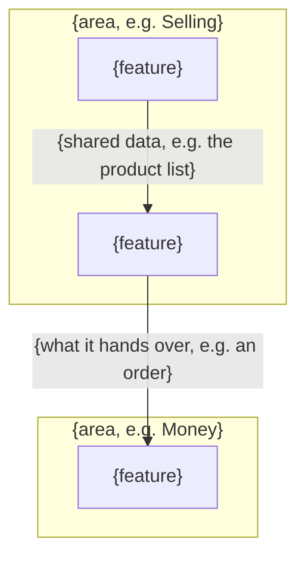
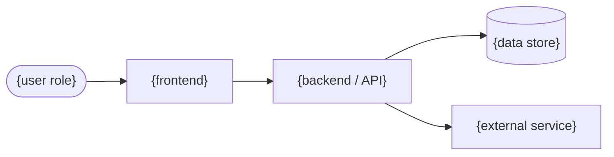
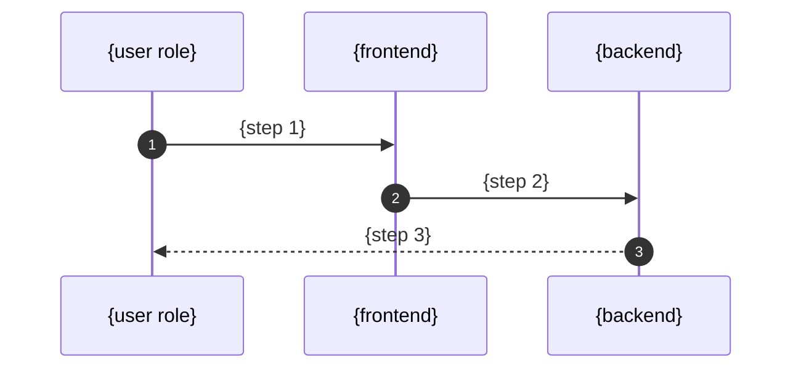

# App map template

The overview of one app: what it is for, what it can do, and how the parts connect. One page,
under about 1,000 words a reader sees (not diagram source), read by scanning the pictures. Shape follows the ARCHITECTURE.md
convention: a map of the country, not an atlas of each state. Names, not links to code, so it
does not rot when files move. Rules and the way to explore the code are in
[overview.md](../references/overview.md). Patch the rows an issue touches; refresh in full about
monthly.

Every diagram: about 10 boxes, never more than 20; `flowchart LR` only for a short chain with no
`subgraph`, otherwise `flowchart TB`, so the text stays readable in Obsidian. Every row names the file it was read from; a
row that was guessed from a name and not read ends with "(inferred)". Anything that could not be
confirmed goes under "Not sure yet", never into a diagram as if it were known.

---

# {App name}: app map

**Verified at:** `{short sha}`, {YYYY-MM-DD} · **Patched by:** {latest issue keys, or "nothing yet"}

## What it is for

{2-3 lines: who uses it and the main thing they do. With more than one kind of user, one line each: "**{role}:** {what they do here}".}

{Only when the user asked for an illustration: one image line for `assets/app-map.png`, its alt text saying what the picture shows. Otherwise delete this line.}

## Core features

{Caption: what someone can do with this app, in one line.}

| Feature | What someone can do | Where it starts | Page |
| ------- | ------------------- | --------------- | ---- |
| {name in the users' words} | {one line, plain words} | `{route, screen, command or job, and the file that holds it}` | {[{name}](features/{feature-name}.md), or "on this page" for a feature too small for its own} |

{At most 9 rows. Smaller features go in one last row, "Also: {names}".}

## How the features connect

{Caption: what the features share or hand to each other, in one line.}

{The conclusion, e.g. "Everything hangs off the order: three features read it, one writes it"}

<ul><li><b>{feature} to {feature}:</b> {how they connect, and the file that shows it}</li></ul>

## The pieces

{Caption: what runs where, in one line.}

{C4 container level only: apps, services, data stores, external systems.}

## One request, end to end

{Caption: the most important thing a user does, traced through every piece.}

## Codemap

| Area | Where | What lives there |
| ---- | ----- | ---------------- |
| {area} | `{top-level dir or module name}` | {one line} |

## What it keeps

{Only when the app stores data: the 3 to 8 main things it keeps, so the feature names make sense. Delete the section otherwise.}

| Thing | What it is | Belongs to | Defined in |
| ----- | ---------- | ---------- | ---------- |
| {e.g. Job application} | {one line, plain words} | {e.g. one Job, one Candidate} | `{model or schema file}` |

## Rules that must hold

- {only what the code enforces or states, with the file, e.g. "only the exams module writes exam tables" (`exams/repo.ts`); "the frontend never calls the database"}

## Glossary

| Word | Means |
| ---- | ----- |
| {domain word} | {plain meaning} |

## Not sure yet

- {a question the code did not answer, and who or what would answer it; delete the section when empty}

## Features built

{Once a feature page or an issue page exists: "See the Features table", linked to `features/README.md`: one row per issue, each linking to its page.}

What agents did, task by task, is in [Run records]({runs/README.md, or ../runs/README.md when a workspace shares one folder}).
