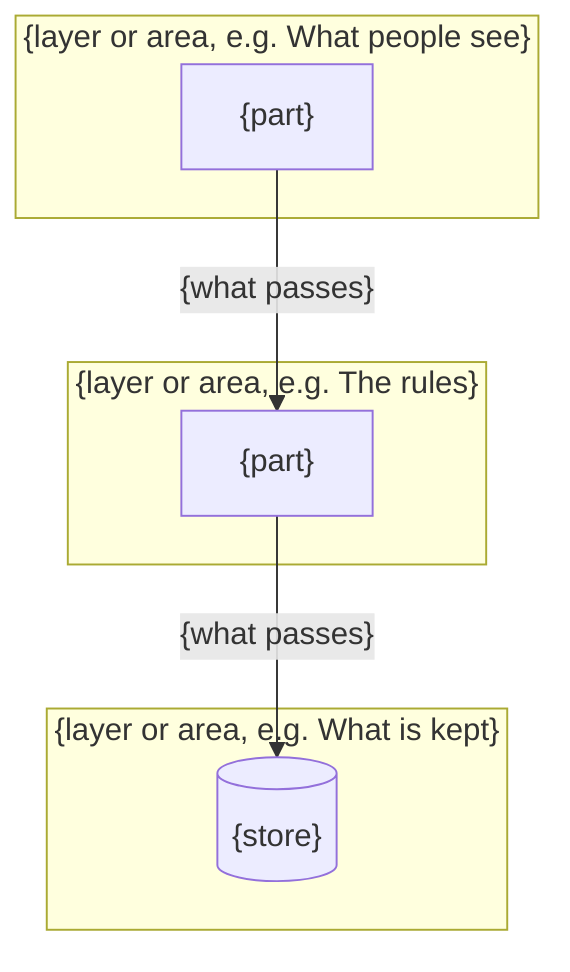
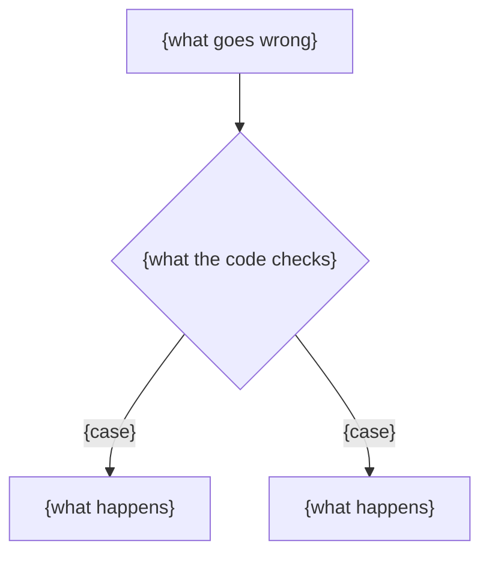

# Architecture page template

How the app is designed, and the system design ideas behind it, for someone learning both at
once: the shape and its name, why it is built that way, what breaks and what gives first, and
lessons to go learn the ideas. One page, about 600 words a reader sees, never more than 900
(`lint-page` reports `too-long`). Rules are in [overview.md](../references/overview.md)
("The architecture page") and [notebook.md](../references/notebook.md). File name:
`architecture.md`, beside the app map. Fill every `{...}`; delete a section that has nothing true
to say, except "Concepts" and "Lessons", which every architecture page keeps (`lint-page` reports
`no-concepts` and `no-lessons`).

The app map's "The pieces" and "One request" already show what runs where and one trace. Never
redraw them here: this page shows the rules between the pieces and the reasons.

---

# {App name}: architecture

**Verified at:** `{short sha}`, {YYYY-MM-DD} · **Pieces and one request:** [app map](app-map.md#the-pieces)

**In one line:** {the architecture style by its usual name (e.g. layered, client-server, modular monolith, event-driven, microservices, pipeline), and what that means here in plain words. Add "(inferred)" when no file names it: the code shows the shape, the name is yours.}

{Only when `.grasp.md` says `illustrations: yes` and an image tool is available: one image line for `assets/architecture.png`, its alt text saying what the picture shows. Otherwise delete this line.}

## The shape

{Caption: which part may call which, in one line.}

{Why this shape, as a conclusion, e.g. "Each layer knows only the one below, so the screen can change without touching the rules"}

{how the code shows the shape, with the files; and one arrow that is NOT there, only when something enforces it}

## Why it is built this way

{Caption: the design choices that shape everything else, one line.}

| Choice | What it buys | What it costs | Seen in |
| ------ | ------------ | ------------- | ------- |
| {e.g. one database for every module} | {e.g. one transaction can span modules} | {e.g. no module scales alone} | `{file}` |

{At most 6. A reason no file states ends with "(inferred)".}

## When something fails

{Caption: the failure that matters most, and what the app does about it, in one line. Only behaviour a file shows.}

## How it grows

{Caption: what gives first when there is more of something. Limits are read from the code; the next step is the usual answer, not a plan.}

| More of | Gives first | Seen in | The usual next step |
| ------- | ----------- | ------- | ------------------- |
| {users, rows, projects, teams} | {the piece and why} | `{file}` | {the system design answer, e.g. "a read replica"} |

{At most 4.}

## Design system

{Only for an app with a UI. Caption: what screens are made from, in one line. Delete the section otherwise.}

| Part | What it is | Defined in |
| ---- | ---------- | ---------- |
| Tokens | {colours, type, spacing: where the values live, how many} | `{file}` |
| Components | {the shared ones: names} | `{folder}` |
| Rules | {only what code or lint enforces, e.g. "no raw hex outside tokens"} | `{file}` |

## Concepts

{Caption: the system design ideas this app uses, one line. At most 5, picked from the sections above.}

- **{Idea, by its usual name}:** {what it is in one plain sentence, and where this app uses it}

{Idea}: {its point as a conclusion}

<b>Everyday picture:</b> {the idea as something outside software, 1 to 2 sentences}

<b>Here:</b> {how this code does it, 2 to 5 lines, with the files}

<b>Use it when:</b> {the problem it solves}. <b>Not when:</b> {what it costs, or the simpler choice}.

<ul><li><a href="{official docs url}">{page title}</a>, {who made it}, official docs, free</li></ul>

Links checked {YYYY-MM-DD}.

## Lessons

{Caption: learn the ideas in this order; each was checked live on {YYYY-MM-DD}.}

| Learn | Watch, free (YouTube) | Course, paid (LinkedIn Learning) |
| ----- | --------------------- | -------------------------------- |
| {idea, as in Concepts} | [{title from check-link}]({video url}), {channel from check-link} | [{course title from check-link}]({final url from check-link}) |

{One row per concept, easiest first. Drop the last column when `.grasp.md` says `linkedin learning: no`. A `|` inside a title is written `\|`. A cell with nothing that passes: "No checked lesson yet".}

## Not sure yet

- {a question the code did not answer; delete the section when empty}
