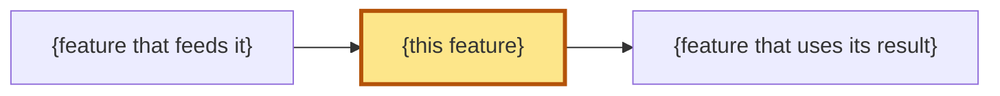
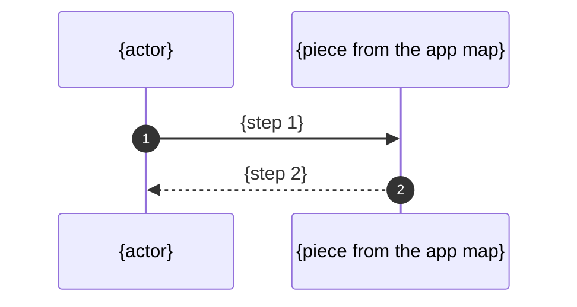

# Feature page template

One page for a core feature of the app that earns it, written when the app is first mapped: how
the feature works today, for someone who has never opened the code. The app map lists the features; this page
explains one. An issue page explains one change; when an issue changes how this feature works,
patch the picture here and add a row under "Changes". File name: `{feature-name}.md` in the
`features/` folder, lowercase joined with `-`. Rules are in
[overview.md](../references/overview.md) and [notebook.md](../references/notebook.md). About 250
words a reader sees, tables included (not diagram source, not folded text). Fill every `{...}`; delete a
section that has nothing true to say: most pages need "Where it fits", "How it works" and
"Connects to", and nothing else.

Write this page only when the feature has a path worth tracing: three or more files or steps. A
feature that lives in one or two short files is explained by its row on the app map.

---

# {Feature name}

Verified at `{short sha}`, {YYYY-MM-DD} · part of the [app map](../app-map.md)

**In one line:** {what someone can do with it, in plain words}

## Where it fits

{Caption: where this feature sits among the others, one line.}

## How it works

{Caption: the one idea behind it, one line.}

Code walkthrough: {n} steps, numbered like the diagram

<b>1.</b> {what this step does; "Arrows 2 to 4" when one function covers several} (<code>{path}</code>, <code>{function or route name}</code>)

<pre><code>{up to 8 lines of the real code, never a whole file, no highlighting}</code></pre>

<b>2.</b> {next step} (<code>{path}</code>, <code>{name}</code>)

<pre><code>{excerpt}</code></pre>

## Connects to

| Feature or piece | How | Seen in |
| ---------------- | --- | ------- |
| {name, as on the app map} | {reads its data, calls it, sends it an event, shares a table} | `{file name}` |

## Rules that must hold

- {only what a check, a constraint, a test or a comment in the code states, e.g. "a refund never exceeds the payment" (`refunds.ts`); delete the section when the code states none}

## Not sure yet

- {a question the code did not answer; delete the section when empty}

## Changes

| When | What changed | Page |
| ---- | ------------ | ---- |
| {YYYY-MM-DD} | {one line} | [{KEY or run name}]({KEY-short-name}.md) |
