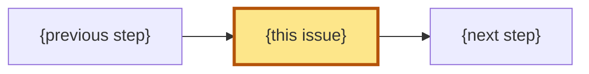
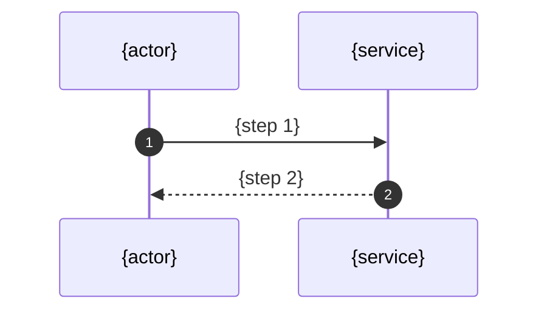
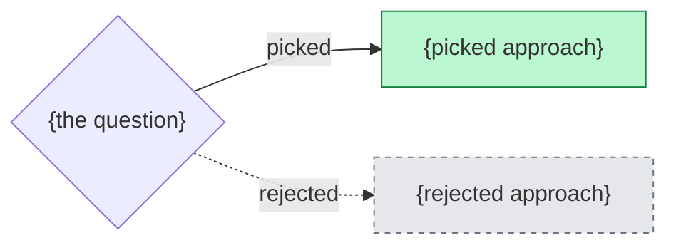

# Issue page template

One page per issue, one layout for both halves. Title: `KEY: short name` (for a text issue, a
short name). Step 3 writes the before half: the sections marked (before). Step 6 writes the
after half: it patches the same sections and adds the ones marked (after). Rules for every
part are in [notebook.md](../references/notebook.md). Fill every `{...}`. Delete a section that
has nothing true to say instead of padding it.

**Visible:** pictures, one-line captions, the status line, blockers, the explain-back question.
**Folded:** everything else, in a toggle directly under the picture it explains. A toggle is a
single HTML block: no blank lines inside, HTML only (`p`, `ul`, `ol`, `li`, `a`, `code`, `pre`,
`b`, `br`). Each toggle title states a conclusion, never "Details". Run
`grasp-tools lint-page PAGE` after every write.

---

# {KEY}: {short name}

Status: {planned | building | built | verified | blocked} · [issue]({issue url}) · [pull request]({pr url, or "not yet"})

> [!WARNING]
> {Blocked: what blocks it and who can unblock it, in one line. Only while blocked; never folded.}

**In one line:** {what someone can do now (after) or will be able to do (before), in plain words}

## Where it fits

{Caption: where this issue sits in the app, one line.} (before)

{Why this matters, as a conclusion, e.g. "Users lose their work after an hour, so we refresh early"}

{the reason, in the asker's words where possible}

<b>Not doing:</b> {what this issue deliberately leaves out}

## Before and after

{Caption: what changed on screen, one line, or "No visible change" and drop the table.} (after, UI changes only)

| Before | After |
| ------ | ----- |
| { from an issue attachment, or "Not captured"} |  |

After, at `{short sha}`, {YYYY-MM-DD}.

Check it yourself in {n} steps

<ol><li>{one command or one click}</li><li>{what you should see}</li></ol>

<b>Verified:</b> {checks run with their result lines, the control result, behaviour seen} on <code>{commit}</code>

## How it works

{Caption: the one idea behind the change, one line. Before: "Expected flow".} (before, replaced after)

Code walkthrough: {n} steps, numbered like the diagram

<b>1.</b> {what this step does} (<a href="{commit-SHA permalink to the lines}">{path}#L{a}-L{b}</a>)

<pre><code>{3 to 8 lines of the real code, no highlighting}</code></pre>

<b>2.</b> {next step} (<a href="{permalink}">{path}#L{a}-L{b}</a>)

<pre><code>{excerpt}</code></pre>

{n} files touched, {m} of them tests

<ul><li><code>{path}</code>: {what it does, one line}</li></ul>

## Decision

{Caption: the decision in one line, "{picked} over {rejected}".} (before)

Why {picked} wins, and what it costs

{the reason}. <b>Costs:</b> {the trade-off}. <b>Biggest risk:</b> {one line}.

Plan vs actual: {"as planned", or the one thing that changed}

{what changed from the plan and why} (after)

## Blocker

> [!WARNING]
> {A blocker met during the build, and how it was resolved or worked around. One alert per blocker. Never folded.} (after)

## Predict

{Visible while planned or building. Once built, move it into the "Your guess" toggle below.} (before)

- Which parts will change? → {user's guess, or "skipped"}
- What is most likely to break? → {user's guess, or "skipped"}

Your guess vs what happened: {one-line verdict}

{the predictions, then one or two lines comparing them with the diff} (after)

## Learn more

{n} links on {concept names}, checked {YYYY-MM-DD}

<ul><li><a href="{official docs url}">{page title}</a>, official docs, free</li><li><a href="{video url}">{title from check-link}</a>, {channel from check-link}, YouTube, free</li><li><a href="{final url from check-link}">{course title}</a>, LinkedIn Learning, paid</li></ul>

## Explain it back

1. {a "why", "what breaks if" or "trace this request" question} (after)
   - Your answer: {filled after they reply}

Model answer

{2 to 4 lines}

**Questions asked:** {one conceptual question the user asked during the run, if any}
