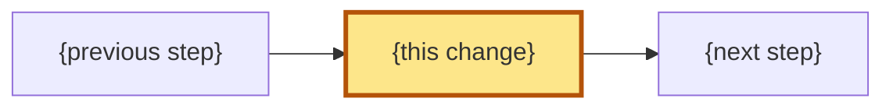

# Issue page template

One page per issue, one layout for both halves. Title: `KEY: short name` (for a text issue, a
short name). The before half is written when the plan is agreed: the status line, both
sentences, the owner block, where it fits, the ideas, the diagram and steps, and the visible
`## Steps` and `## Predict`. The after half patches the same sections and fills the folds under
`## More detail`. Rules for every part are in [notebook.md](../references/notebook.md). Fill every
`{...}`. Delete a line that has nothing true to say instead of padding it.

**Length:** target 300 visible words, never over 400. Toggles and code are not counted.
**Visible:** the status line, both sentences, the owner block, one line of where it fits, one line
per idea, the diagram and its numbered steps, the link to the code page, blockers.
**Folded:** everything else, in a toggle. A toggle is a single HTML block: no blank lines inside,
HTML only (`p`, `ul`, `ol`, `li`, `a`, `code`, `pre`, `b`, `br`, `table`, `tr`, `th`, `td`). Each
toggle title states a conclusion, never "Details". Run `grasp-tools lint-page PAGE` after every write.

- `## How it works` is one diagram then 4 to 7 numbered steps, one line each, then one line that
  links the code page.
- Each idea is one visible line, then a `
` with 3 to 5 lines tied to this code (two lines for a design idea the reader
  profile lists under `knows well`). Its links
  are `<a href>` followed by `· title · author · checked YYYY-MM-DD`. The first idea is the design
  idea and holds one video.
- The Proof fold is an HTML `<table>` with the columns acceptance point, command or check, result line.
- The walk fold sits between the walk markers. It starts as the empty fold below and only a walk
  changes it.
- While `Status: planned` or `building`, a visible `## Steps` list and a `## Predict` question sit
  above `## More detail`. At `built`, both move into the "Planned and built" fold.
- A blocker is a `> [!WARNING]` alert under the title, never folded.
- **`explain` only:** `/grasp explain` adds the three folds `Set it up`, `When something goes
  wrong` and `How we built it, step by step`, between "Open and not verified" and the walk fold,
  and its title has no key ([explain.md](../references/explain.md)). Delete those three folds on
  every other page.

---

# {KEY}: {short name}

Status: {planned | building | built | verified | blocked} · Standard: 2 · Feature: {link to the feature page, or none} · Walk: not walked · [issue]({issue url}; for a text issue write "text issue" with no link) · [pull request]({pr url, or "not yet"})

Checked against: `{repo}@{base}..{head}`, `{repo}@{base}..{head}` on {YYYY-MM-DD}

> [!WARNING]
> {Blocked: what blocks it and who can unblock it, in one line. Only while blocked; never folded.}

## In two sentences

{What users can do now (after) or will be able to do (before), then what was true before. Plain words.}

## For the owner

- **Asked:** {the request, in the asker's words, 30 words at most}
- **Users can now:** {what a person can do that they could not, or "nothing yet" while planned}
- **Risk:** {the one thing most likely to go wrong, or "none known"}
- **Not done:** {what this issue deliberately leaves out}
- **Needs a decision:** {the open question for the owner, or "nothing"}

## Where it fits

{One line: where this issue sits in the app, and what it touches. Under it, the change map from `grasp-tools change-map`, with this issue's parts highlighted.}

## Ideas this leans on

- **Design · {design idea}:** {one line: the architecture pattern or system design concept behind this change}

{Design idea}: how it works here, and where to learn it

{3 to 5 lines, plain words, tied to this code and not a textbook definition}

Watch: <a href="{one YouTube video, or one LinkedIn Learning video inside a course}">{title from check-link}</a> · {channel}{ · n min, only when read from the video's page; otherwise leave it out} · {content checked | title match only} · checked {YYYY-MM-DD}

Read: <a href="{official docs url}">{page title}</a> · {site} · checked {YYYY-MM-DD}

- **Idea · {another idea}:** {one line. Add one only when the change leans on it. Same fold as above.}

{With no video that passes the check, the Watch line is `
No checked video yet
`. With lessons switched off it is `
Lessons turned off
`.}

## How it works

1. {step 1, one line}
2. {step 2}
3. {step 3}
4. {step 4}

[The code, file by file]({KEY}-{slug}-code.md)

## Steps

{Only while planned or building. The plan in 3 to 6 steps; tick each box the moment the build finishes the step.}

- [ ] {step 1, something a person could check}
- [ ] {step 2}

## Predict

{Only while planned or building. The one question asked before the build.}

- {the question} → {the guess, or "skipped"}

## More detail

Why it was built this way: {the reason as a conclusion}

{the reason, and the approach picked over the one rejected, in the asker's words where possible}

<b>Questions asked:</b> {a conceptual question the person asked during the run. Omit this line when there was none.}

Planned and built: {n} of {m} steps as planned

<ol><li>{each planned step, and what was built instead when it changed}</li></ol>

{At built: the guess against what happened, in one or two lines.}

Proof it works: {n} of {m} acceptance points pass

<table><tr><th>Acceptance point</th><th>Command or check</th><th>Result line</th></tr><tr><td>{point}</td><td><code>{command}</code></td><td>{result line}</td></tr></table>

Open and not verified: {what is still open}

{what was not checked, and why}

Set it up: {n} commands, then one that shows it worked

<ol><li><code>{command}</code></li><li><code>{command that shows it worked}</code></li></ol>

When something goes wrong: {n} cases, each with its fix

<table><tr><th>What you see</th><th>What to do</th></tr><tr><td>{the real message}</td><td>{the fix}</td></tr></table>

How we built it, step by step: {n} steps, {what went wrong, in a few words}

<ol><li>{what was done, what went wrong there and how it was fixed}</li></ol>

<!-- grasp:walk:start -->

Your walk: not done yet. Run /grasp walk {KEY}

<!-- grasp:walk:end -->
