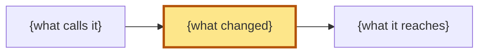

# Run record template

One small page per agent task that changed files, so anyone can see what happened without reading
a transcript. Read in under a minute: a title, a status line and five fixed lines. Everything
after the five lines is optional. Rules are in [records.md](../references/records.md). File name:
`YYYY-MM-DD-short-name.md` in the run records folder. Fill every `{...}`; delete an optional part
that has nothing true to say.

`grasp-tools record-index` reads the title, the first word after `Status:`, and the **Changed** and
**Problems** lines to build the table of all runs, so keep those lines in this exact form.

---

# {YYYY-MM-DD}: {short name}

Status: {done | partial | blocked | failed} · {agent, e.g. Claude Code} · branch `{branch}` · [pull request]({pr url, or drop this link}) · [issue page](../features/{KEY-short-name}.md)

- **Asked:** {the request in one sentence, in the asker's words}
- **Changed:** {what behaves differently now, in plain words; "nothing yet" when the run failed}
- **Checked:** {`the command`: its result line; or "not checked" and why}
- **Problems:** {what failed, was worked around or is uncertain; or "none"}
- **Next:** {the one thing a person should do or decide next; or "nothing"}

{Caption: the shape of the change in one line. Drop the caption and the picture for a change with no shape (copy, config, a one-line fix), and when the issue page already has the picture.}

> [!WARNING]
> {One alert per problem that needs more than its one line: what happened, what was done about it, what is still open. Never folded.}

{n} files touched, {m} of them tests

<ul><li><code>{path}</code>: {what changed, one line}</li></ul>

