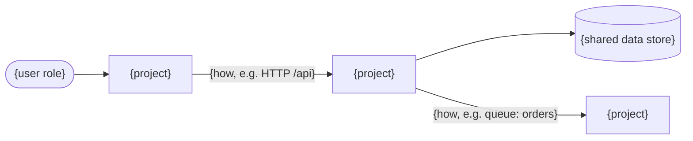
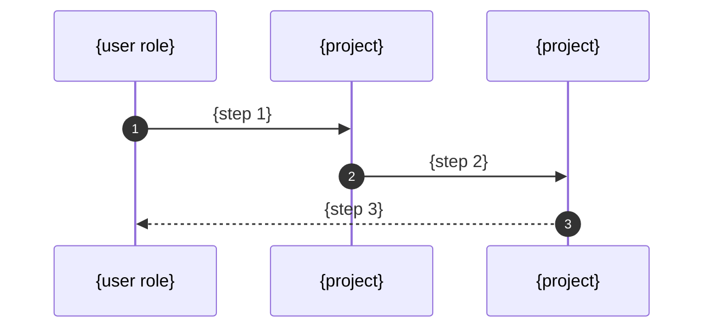

# Workspace map template

For a top folder that holds several projects (separate repositories, or apps in one monorepo):
one page on how the projects fit together. Each project keeps its own app map; this page links
them and shows what passes between them. About 600 words a reader sees, never more than 1,100
(`lint-page` reports `too-long`). Rules are in
[overview.md](../references/overview.md). Fill every `{...}`.

A connection is drawn only when a file shows it. The table says which file, and "sure" only when
that file was read; a connection guessed from a name (an env var called `API_URL`) says
"inferred".

---

# {Workspace name}: how the projects fit

**Verified:** {YYYY-MM-DD}

## What it is for

{2-3 lines: the product these projects make together, and who uses it}

{Only when `.grasp.md` says `illustrations: yes` and an image tool is available: one image line for `assets/workspace-map.png`, its alt text saying what the picture shows. Otherwise delete this line.}

## The projects

| Project | Kind | Built with | Owns | Overview | Verified at |
| ------- | ---- | ---------- | ---- | -------- | ----------- |
| {name} | {repository or package} | {main language and framework} | {what only this project does, one line} | [app map]({path to its app-map.md}) | `{short sha}` |

{Only in a small workspace, where the projects get no app maps of their own: a "Core features" section here, one table: feature, project, where it starts; and a "Concepts" section shaped as on the app map template (one visible line per concept, the long explanation and checked links in a toggle). Add a "Features built" section as on the app map template too, since this page stands in for the app map. Then drop the Overview column above.}

## How they connect

{Caption: what passes between the projects, in one line.}

| From | To | How | Seen in | Sure? |
| ---- | -- | --- | ------- | ----- |
| {project} | {project or store} | {HTTP, shared package, queue or topic, database, file} | `{file name}` | {sure or inferred} |

## One journey across the projects

{Caption: one thing a user does that crosses the most projects.}

## Not sure yet

- {a connection that could not be confirmed, and what would confirm it; delete the section when empty}

## Run records

{One line per project that keeps its own: [name]({path to its runs/README.md}). With one shared folder: [Run records](runs/README.md).}
