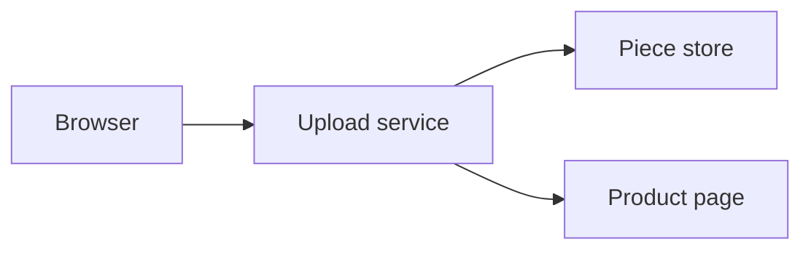

# SHOP-12: Resumable photo uploads

Status: built · Standard: 2 · Feature: none · Walk: not walked · [issue](https://example.com/shop/SHOP-12) · [pull request](https://example.com/shop/pull/12)

Checked against: `web@1a2b3c4..5d6e7f8`, `api@9a8b7c6..0f1e2d3` on 2026-11-26

## In two sentences

Sellers can now upload a product photo in pieces, so a dropped connection resumes where it stopped. Before, one failure sent the whole photo again.

## For the owner

- **Asked:** let sellers upload large product photos on a weak connection without starting over.
- **Users can now:** resume an interrupted photo upload from the last piece that arrived.
- **Risk:** half-sent uploads stay on the server until the nightly cleanup removes them.
- **Not done:** video uploads, and uploads from the mobile app.
- **Needs a decision:** how long the server keeps a half-sent upload, now one day.

## Where it fits

The seller's browser sends pieces to the upload service, which hands the finished photo to the product page.

## Ideas this leans on

- **Design · Resumable upload:** a big file goes up in pieces, so one failure resends one piece.

Resumable upload: how it works here, and where to learn it

The browser cuts the photo into 1 MB pieces and numbers them. The service keeps the pieces by upload id and answers which numbers it already holds. After a failure the browser asks, then sends only the missing ones.

Watch: <a href="https://www.youtube.com/watch?v=aBcDeFgHiJk&t=95s">Resumable uploads explained</a> · Shop Dev Talks · 12 min · content checked · checked 2026-11-26

Read: <a href="https://example.com/docs/resumable-uploads">Resumable upload protocol</a> · Example Docs · checked 2026-11-26

## How it works

1. The browser cuts the photo into numbered pieces.
2. It asks the service which pieces it already holds.
3. It sends only the missing pieces, in order.
4. The service stores each piece under the upload id.
5. When the last piece lands, the service joins them and publishes the photo.

[The code, file by file](example-issue-page-code.md)

## More detail

Why it was built this way: pieces beat one long request

A single long request fails as a whole on a weak connection. Pieces make the retry cost one piece, at the price of one extra question before each resume.

Planned and built: 4 of 4 steps as planned

<ol><li>A test that drops the connection half way.</li><li>Cut and number the pieces.</li><li>Resume from the missing piece.</li><li>Join the pieces and publish.</li></ol>

Proof it works: 2 of 2 acceptance points pass

<table><tr><th>Acceptance point</th><th>Command or check</th><th>Result line</th></tr><tr><td>A dropped upload resumes</td><td><code>npm test -- resume</code></td><td>1 passed, 0 failed</td></tr><tr><td>A finished upload is joined once</td><td><code>npm test -- join</code></td><td>1 passed, 0 failed</td></tr></table>

Open and not verified: slow networks were not tried

Only a fast local connection was used. Pieces of 1 MB were not tuned for a slow one.

<!-- grasp:walk:start -->

Your walk: not done yet. Run /grasp walk SHOP-12

<!-- grasp:walk:end -->
