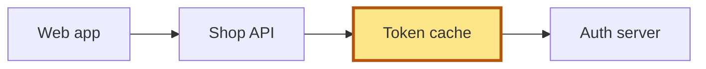
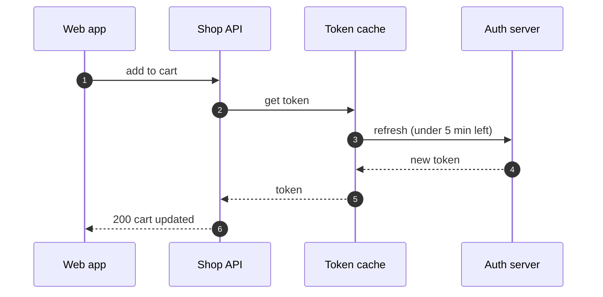
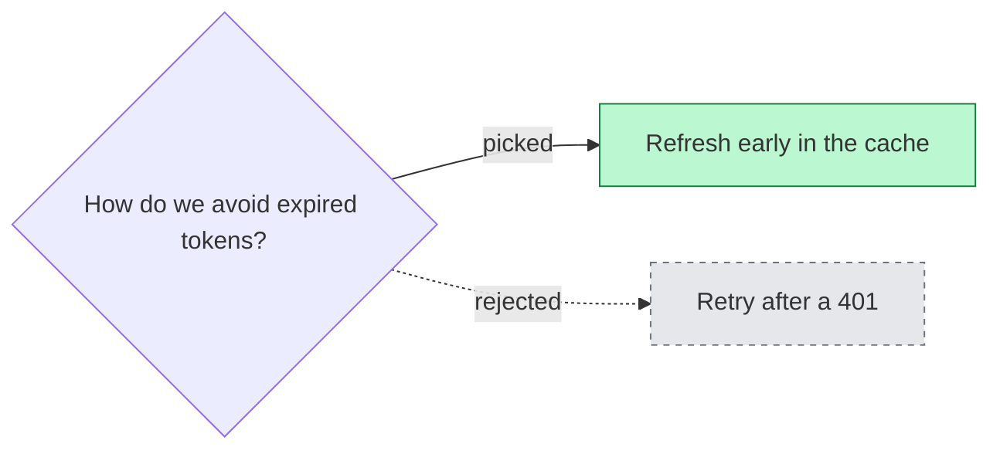

# PROJ-42: Keep users signed in past one hour

Status: verified · [issue](https://example.atlassian.net/browse/PROJ-42) · [pull request](https://github.com/acme/shop/pull/118)

**In one line:** signed-in shoppers stay signed in all day instead of being logged out after an hour.

## Where it fits

The token cache sits between every API call and the auth server.

Shoppers lost their carts at the one-hour mark, so we refresh tokens early

Support saw 40 tickets a week about carts emptying mid-checkout. The access token lasts one hour and nothing refreshed it.

<b>Not doing:</b> refresh for service accounts (PROJ-51) or "remember me" across browser restarts.

## Before and after

The session banner no longer appears after an hour of browsing.

| Before | After |
| ------ | ----- |
|  |  |

After, at `a1b2c3d`, 2026-11-20.

Check it yourself in 3 steps

<ol><li>Run <code>npm run dev</code> and sign in.</li><li>Set the clock forward with <code>TOKEN_TTL=60 npm run dev</code> and wait 70 seconds.</li><li>Add an item to the cart: it works and no banner appears.</li></ol>

<b>Verified:</b> <code>npm test</code> 212 passed; control run on <code>main</code> shows the banner; cart add seen working at 70 s, on <code>a1b2c3d</code>.

## How it works

Every API call checks the token's age first and refreshes it when under five minutes remain.

Code walkthrough: 3 steps, numbered like the diagram

<b>2.</b> The API asks the cache, never the auth server directly (<a href="https://github.com/acme/shop/blob/a1b2c3d/src/api/client.ts#L18-L20">src/api/client.ts#L18-L20</a>)

<pre><code>const token = await tokenCache.get();
headers.Authorization = `Bearer ${token}`;</code></pre>

<b>3.</b> The cache refreshes early (<a href="https://github.com/acme/shop/blob/a1b2c3d/src/auth/cache.ts#L31-L36">src/auth/cache.ts#L31-L36</a>)

<pre><code>if (this.expiresAt - Date.now() &lt; FIVE_MINUTES) {
  this.current = await this.refresh();
}
return this.current.token;</code></pre>

<b>4.</b> One refresh at a time: concurrent callers share the same promise (<a href="https://github.com/acme/shop/blob/a1b2c3d/src/auth/cache.ts#L40-L44">src/auth/cache.ts#L40-L44</a>)

4 files touched, 2 of them tests

<ul><li><code>src/auth/cache.ts</code>: the token cache and early refresh</li><li><code>src/api/client.ts</code>: reads the token from the cache</li><li><code>src/auth/cache.test.ts</code>: refresh timing and the single-flight rule</li><li><code>e2e/session.spec.ts</code>: the 70-second session test</li></ul>

## Decision

Refresh early in the cache, over retrying after a 401.

Refreshing early avoids a failed request, at the cost of one timer per tab

A retry still fails the first request after expiry and doubles its latency. <b>Costs:</b> each open tab refreshes on its own. <b>Biggest risk:</b> two tabs refreshing at once, covered by the single-flight rule.

Plan vs actual: added the single-flight rule

The review found parallel calls each starting a refresh, so step 4 was added.

## Blocker

> [!WARNING]
> The staging auth server was down for a day. Tested against a local stub; re-checked on staging once it was back.

## Predict

Your guess vs what happened: right about the cache, missed the race

Guessed "the API client changes" and "logout breaks". The client did change; logout was fine, but parallel refreshes raced.

## Learn more

2 links on OAuth refresh tokens, checked 2026-11-20

<ul><li><a href="https://datatracker.ietf.org/doc/html/rfc6749#section-1.5">RFC 6749, section 1.5: Refresh Token</a>, official spec, free</li><li><a href="https://www.linkedin.com/learning/web-security-oauth-and-openid-connect-23016424">Web Security: OAuth and OpenID Connect</a>, LinkedIn Learning, paid</li></ul>

## Explain it back

1. What happens when two tabs call the API at the same moment, four minutes before expiry?
   - Your answer: both refresh? Not sure.

Model answer

Each tab has its own cache, so each refreshes once. Inside one tab, the second call waits on the first call's refresh promise instead of starting another.

**Questions asked:** "Why not store the token in localStorage?"
