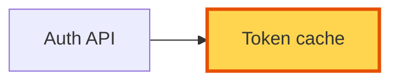

# PROJ-12: Refresh tokens before they expire

Status: built · [PROJ-12](https://example.atlassian.net/browse/PROJ-12) · [PR #40](https://github.com/acme/app/pull/40)

In one line: signed-in users stay signed in past one hour.

> [!WARNING]
> Blocked on the staging auth server for a day; tested against a local stub instead.

## Where it fits

The token cache sits between the API and the auth server.



<details><summary>We refresh early instead of retrying on 401</summary>
<p>A retry doubles the latency of the first request after expiry.</p>
<ul><li>Not doing: refresh tokens for service accounts</li></ul>
<pre><code># refresh five minutes early
- const ttl = 3600;
+ const ttl = 3300;</code></pre>
</details>

## Before and after

| Before | After |
| ------ | ----- |
| No visible change |  |

Code walkthrough excerpt, permalinked to [src/auth.ts](https://github.com/acme/app/blob/abc1234/src/auth.ts#L10-L14):

```ts
if (expiresAt - now < 5 * 60_000) await refresh();
```

Comparing `a == b` in inline code is fine, and so is `[[not a link]]`.

## Explain it back

What happens to a request made four minutes before expiry?

<details><summary>Model answer</summary>
<p>It triggers a refresh first, then runs with the new token.</p>
</details>
