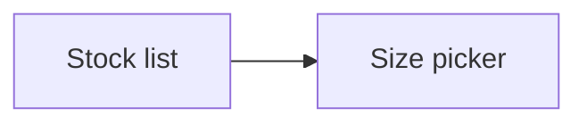

# SHOP-14: Hide sold-out sizes

Status: built · Standard: 2 short · Feature: none · Walk: not walked · [issue](https://example.com/shop/SHOP-14) · [pull request](https://example.com/shop/pull/14)

Checked against: `web@1a2b3c4..5d6e7f8` on 2026-11-26

## In two sentences

Shoppers no longer see sizes that are sold out. The size picker lists only what the shop can ship.

## For the owner

- **Asked:** stop showing sizes that are sold out.
- **Users can now:** pick only from sizes that are in stock.
- **Risk:** a size sold a second ago can still show until the page reloads.
- **Not done:** a back-in-stock alert.
- **Needs a decision:** nothing.

## How it works

1. The product page loads the stock list.
2. The picker drops every size with zero stock.
3. The picker shows what is left.
4. An empty picker shows "sold out".

## Every changed file

- `web/src/product/sizes.ts`: drops sizes with zero stock.
- `web/src/product/sizes.test.ts`: covers the sold-out cases.
