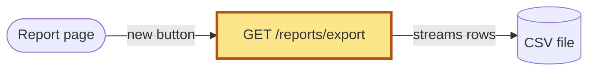

# 2026-11-20: CSV export on the report page

Status: done · Claude Code · branch `feat/csv-export` · [pull request](https://github.com/acme/app/pull/12)

- **Asked:** Add a CSV export button to the report page.
- **Changed:** Anyone on the report page can download the rows they see as a CSV file.
- **Checked:** `npm test`: `Tests: 212 passed, 212 total`. Clicked the button on a filtered report; the file held the 14 filtered rows.
- **Problems:** Dates export in UTC, not the user's time zone.
- **Next:** Decide whether exported dates should use the user's time zone.

The report page gained one button; the server gained one endpoint that streams the rows.

4 files touched, 1 of them a test

<ul><li><code>web/report/ExportButton.tsx</code>: the button</li><li><code>api/reports/export.ts</code>: the streaming endpoint</li><li><code>api/reports/export.test.ts</code>: the endpoint test</li><li><code>api/routes.ts</code>: the route</li></ul>

