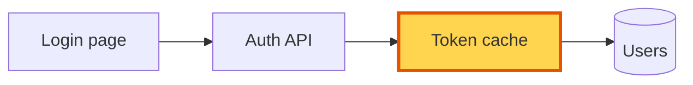
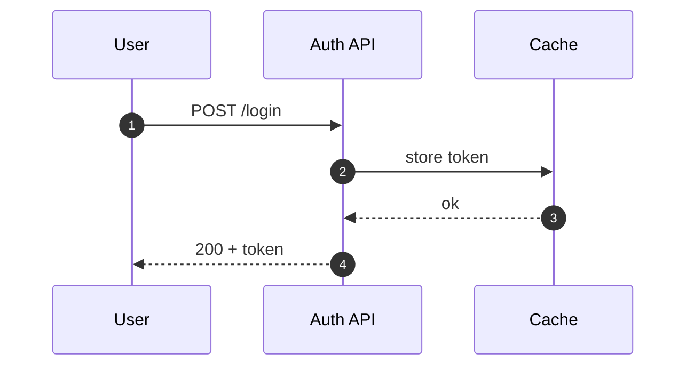

# Obsidian render check

Open this file in Obsidian (reading view and live preview) and on GitHub. Each section says what
should happen. Results are recorded in `docs/research/visual-pages.md`.

## (a) HTML toggle: one block, no blank lines, HTML only

Expected: folded by default; opens to a paragraph, a list and a code block.

<details><summary>Why we cache the token (click to open)</summary>
<p>The token is valid for one hour, so we keep it in memory and refresh it five minutes early.</p>
<ul><li>Fewer calls to the auth server</li><li>No token on disk</li></ul>
<pre><code>const token = await cache.get("auth") ?? await refresh();</code></pre>
</details>

## (b) FORBIDDEN: HTML toggle with blank lines and Markdown inside

Expected to break in Obsidian (Markdown shown raw or the toggle splits). Kept here to prove why
`lint-page` forbids it.

<details><summary>Markdown inside (forbidden)</summary>

- a Markdown bullet
- **bold text**

```js
console.log("fenced code inside details");
```

</details>

## (c) Foldable callout with Mermaid and code inside

Expected in Obsidian: folded by default, opens to a diagram and code. On GitHub: an open quote
block with a `[!info]-` marker. Because GitHub shows it open, pages don't use it and `lint-page`
flags it.

> [!info]- How the refresh works (click to open)
> The refresh runs before expiry.
>
> ```mermaid
> flowchart LR
>   A[Request] --> B{Token fresh?}
>   B -- yes --> C[Call API]
>   B -- no --> D[Refresh] --> C
> ```
>
> ```js
> if (expiresAt - now < 5 * 60_000) await refresh();
> ```

## (d) Mermaid flowchart with a highlighted node

Expected: a diagram with the "Token cache" node highlighted.



## (e) Mermaid sequence diagram with autonumber

Expected: numbered arrows 1 to 4.



## (f) The five alerts

> [!NOTE]
> Note alert.

> [!TIP]
> Tip alert.

> [!IMPORTANT]
> Important alert.

> [!WARNING]
> Warning alert: blocked on the staging database.

> [!CAUTION]
> Caution alert.

## (g) Before and after screenshot table

| Before | After |
| ------ | ----- |
| No visible change |  |

## (h) Diff fence

```diff
- const ttl = 3600;
+ const ttl = 3300; // refresh five minutes early
```

## (i) Relative link

Back to the [README](../../README.md).
